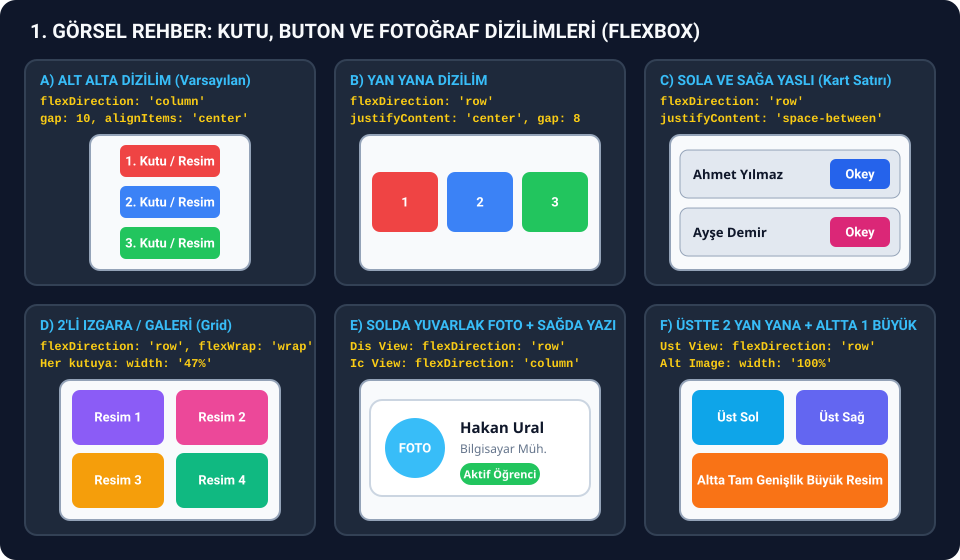
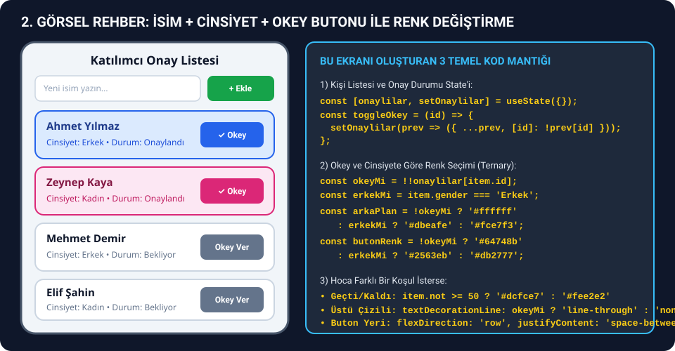
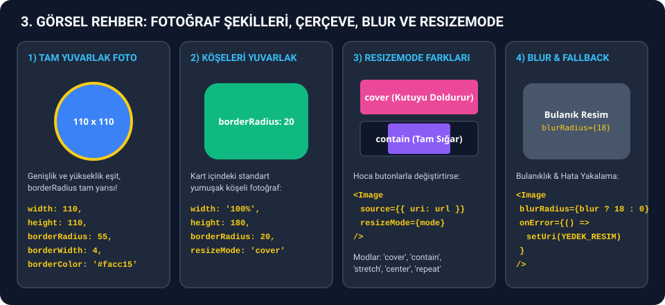

# 🚀 REACT NATIVE & SNACK EXPO SINAV SIDE-KICK REHBERİ (W2 – W6 TAM KAPSAM)

> **Sınavda Nasıl Kullanılır?**
> 1. Bu sayfayı [snack.expo.dev](https://snack.expo.dev) yanına aç ve **`Ctrl + F` (Mac'te `Cmd + F`)** tuşuna basarak hocanın verdiği görseldeki anahtar kelimeyi veya ders kodunun adını ara (*örn: `yan yana`, `alt alta`, `yuvarlak`, `cinsiyet`, `okey`, `geçti`, `kalın`, `italik`, `üstü çizili`, `4 işlem`, `vize`, `sayaç`, `timer`, `checkbox`, `radio`, `picker`, `blur`, `CourseModules`, `SumCalculator`, `SimpleCounter`, `DynamicVariableExample`, `ResponsiveGrid`, `ImagePlayground`*).
> 2. Her görsel senaryonun içinde **hocanın bu konuyu hangi haftada (`W2`, `W3`, `W4`, `W6`), hangi dosyada, hangi konu başlığı ve hangi fonksiyon adıyla işlediği** açıkça belirtilmiştir.
> 3. Ayrıca her senaryoda hem **hocanın ders notundaki orijinal örnek kodu** hem de **sınavda değiştirtmek isteyeceği geliştirilmiş senaryo kodu** alt alta yer alır.
> 4. Tüm açıklamalar **kodların hemen üstünde** yer alır; kod bloklarının ve `.js` dosyalarının içinde **hiçbir yorum satırı yoktur**, doğrudan kopyalayıp Snack Expo `App.js` içine yapıştırabilirsin!

---

## 📂 HIZLI ERİŞİM MENÜSÜ (Detaylı Görsel Rehberler & Hazır `App.js` Dosyaları)

### 📘 Konu Bazlı Detaylı Senaryo Rehberleri (Hafta/Konu Karşılıkları + Orijinal Ders Kodları + Sınav Senaryoları)
1. 📸 **[01 - Fotoğraf Koyma, Yan Yana / Alt Alta / 2x2 Galeri, Yuvarlak Profil ve Flexbox (`W6 View.md`, `Image.md`, `ScrollView.md`)](./SINAV_REHBERI/01_FOTOGRAF_KOYMA_YANYANA_ALTALTA_VE_FLEXBOX.md)**
2. 👥 **[02 - İsim + Cinsiyet + Okey Butonu ile Renk Değiştiren Dinamik Listeler (`W2`, `W3`, `W6 FlatList.md`)](./SINAV_REHBERI/02_ISIM_CINSIYET_OKEY_BUTONU_VE_RENKLI_LISTELER.md)**
3. 🎨 **[03 - Buton Yeri/Rengi, Yazı Tipi/Stili, Yazı Ekleme ve Etkileşimli Kartlar (`W4 Props`, `W6 Text.md`, `TouchableOpacity.md`, `SafeAreaView.md`)](./SINAV_REHBERI/03_BUTON_YERI_RENGI_YAZI_TIPI_VE_ETKILESIM.md)**
4. ⏱️ **[04 - Sayaçlar, Progress Bar, Zamanlayıcılar (Timer), `useState` ve `useEffect` (`W4 Variable/Const`, `State`, `Hooks`, `W6 Button.md`)](./SINAV_REHBERI/04_SAYAC_ZAMANLAYICI_HOOKS_VE_STATE.md)**
5. 🧮 **[05 - Form, TextInput, 4 İşlem, Vize-Final, Checkbox, RadioButton ve Picker (`W4 State/Hooks`, `W6 Button/TextInput/Checkbox/RadioButton/Picker/ScrollView`)](./SINAV_REHBERI/05_FORM_INPUT_HESAPLAMA_CHECKBOX_RADIO_PICKER.md)**
6. 🗺️ **[06 - W2 – W6 Tüm Ders Kodları Haritası, Hafta/Konu Eşleştirme Tablosu ve Hızlı Değişiklik Rehberi](./SINAV_REHBERI/06_DERS_KODLARI_HARITASI_VE_HIZLI_DEGISIKLIK.md)**

### ⚡ Tek Tıkla Kopyalanabilir Hazır `App.js` Şablonları (Yorum Satırsız)
- 📄 **[`01_Isim_Cinsiyet_Okey_Listesi.js`](./SINAV_REHBERI/snack-hazir-kodlar/01_Isim_Cinsiyet_Okey_Listesi.js)** — *İsimlerin yanında Okey butonu; basınca Erkek -> Mavi, Kadın -> Pembe olan liste (`W6 FlatList.md` + `W2/06_control_flow.js`)*
- 📄 **[`02_Fotografli_Isim_Cinsiyet_Ve_Filtreleme.js`](./SINAV_REHBERI/snack-hazir-kodlar/02_Fotografli_Isim_Cinsiyet_Ve_Filtreleme.js)** — *Yuvarlak fotoğraflı + İsim/Cinsiyet + Okey & Sil butonu + Yeni Kişi Ekleme + Filtreleme (`W6 FlatList.md` + `W3/08-list-rendering-example.jsx`)*
- 📄 **[`03_YanYana_AltAlta_Yuvarlak_Fotograf_Galerisi.js`](./SINAV_REHBERI/snack-hazir-kodlar/03_YanYana_AltAlta_Yuvarlak_Fotograf_Galerisi.js)** — *Yuvarlak profil kartı + Butonla Yan Yana / Alt Alta değişen fotoğraflar + Blur + 2x2 Galeri (`W6 View.md` + `Image.md`)*
- 📄 **[`04_Buton_Yazi_Tipi_Rengi_Ve_Kartlar.js`](./SINAV_REHBERI/snack-hazir-kodlar/04_Buton_Yazi_Tipi_Rengi_Ve_Kartlar.js)** — *Butonlarla yazı rengi/fontu/kalın/italik/üstü çizili değiştirme + Favori & Açılır SSS Kartı (`W4 Props` + `W6 Text.md` & `TouchableOpacity.md`)*
- 📄 **[`05_DortIslem_Ve_VizeFinal_Hesaplayici.js`](./SINAV_REHBERI/snack-hazir-kodlar/05_DortIslem_Ve_VizeFinal_Hesaplayici.js)** — *4 İşlem (+, -, ×, ÷) Hesap Makinesi ve Vize-Final Geçti/Kaldı Hesaplayıcı (`W6 Button.md SumCalculator` + `W2/05_operators.js`)*
- 📄 **[`06_Sayac_Progress_Ve_Timer.js`](./SINAV_REHBERI/snack-hazir-kodlar/06_Sayac_Progress_Ve_Timer.js)** — *0-10 Sınırlı Akıllı Sayaç + Yüzde Doluluk Barı + 10s Geri Sayım Sayacı (`W4 DynamicVariableExample` + `W6 CountdownController`)*
- 📄 **[`07_Checkbox_Radio_Picker_Ve_Arama.js`](./SINAV_REHBERI/snack-hazir-kodlar/07_Checkbox_Radio_Picker_Ve_Arama.js)** — *Seçildikçe üstü çizilen Checkbox görev listesi + Arama Filtresi + RadioButton (`W6 Checkbox.md`, `RadioButton.md`, `TextInput.md`)*
- 📄 **[`08_Form_Dogrulama_Ve_Karakter_Sayaci.js`](./SINAV_REHBERI/snack-hazir-kodlar/08_Form_Dogrulama_Ve_Karakter_Sayaci.js)** — *Yeşil/Kırmızı çerçeveli E-posta doğrulama + 120 Karakter Sayacı + Kayıt Formu (`W4 SimpleForm` + `W6 EmailField` & `BioField`)*

---

# 📅 HAFTA HAFTA (`W2`, `W3`, `W4`, `W6`) HOCANIN İŞLEDİĞİ KODLAR VE GÖRSEL SENARYO HARİTASI

| İşlendiği Hafta ve Ders Dosyası | Ders Notundaki Konu Başlığı ve Orijinal Kod Adı | Ekranda Nasıl Görünür? (Görsel İpucu) | Orijinal Kod + Sınav Senaryosu Hangi Rehberde? |
| :--- | :--- | :--- | :--- |
| **W2** (`03`–`09` JS Dosyaları) & **W3** (`02`–`13` JSX Dosyaları) | `06_control_flow.js` (`?:`), `09_arrays.js` (`.map`, `.filter`, `.reduce`), `08-list-rendering-example.jsx` (`InteractiveTaskList`) | İsim/ürün listeleri, koşula göre renk değişimi, filtreleme butonları, kişi ekleme/silme | **[Bölüm 02](./SINAV_REHBERI/02_ISIM_CINSIYET_OKEY_BUTONU_VE_RENKLI_LISTELER.md)** & **[Bölüm 06](./SINAV_REHBERI/06_DERS_KODLARI_HARITASI_VE_HIZLI_DEGISIKLIK.md)** |
| **W4** (`2-example-hello-expo.md`) | `Basic App.js` & `Interactive Version` (`App`) | `Hello React Native 🚀` veya `Click Count: X` mavi butonu (5 tıklamada `Alert`, uzun basınca `Platform` bilgisi) | **[Bölüm 04 - Senaryo 3](./SINAV_REHBERI/04_SAYAC_ZAMANLAYICI_HOOKS_VE_STATE.md)** |
| **W4** (`3-react-native-variable-const.md`) | `Example 1` (`VariableExample`) & `Example 2` (`DynamicVariableExample`) | Sol mavi şeritli 4 bilgi kutusu VEYA 0-10 arası `Progress: %...` gösteren akıllı sayaç | **[Bölüm 04 - Senaryo 2](./SINAV_REHBERI/04_SAYAC_ZAMANLAYICI_HOOKS_VE_STATE.md)** |
| **W4** (`4-react-native-props.md`) | `Example 1` (`MessageExample`) & `Example 2` (`ButtonExample`) | Sol kenarı Mavi/Yeşil/Sarı şeritli mesaj kutuları ve alt alta Mavi/Yeşil/Kırmızı/Gri butonlar | **[Bölüm 03 - Senaryo 4](./SINAV_REHBERI/03_BUTON_YERI_RENGI_YAZI_TIPI_VE_ETKILESIM.md)** |
| **W4** (`5-react-native-state.md`) | `Example 1` (`SimpleCounter`) & `Example 2` (`SimpleForm`) | Yuvarlak `-` / `+` ve `Reset` sayacı VEYA İsim/E-posta `Submit` kayıt formu | **[Bölüm 04 - Senaryo 1](./SINAV_REHBERI/04_SAYAC_ZAMANLAYICI_HOOKS_VE_STATE.md)** & **[Bölüm 05 - Senaryo 3](./SINAV_REHBERI/05_FORM_INPUT_HESAPLAMA_CHECKBOX_RADIO_PICKER.md)** |
| **W4** (`6-react-native-hooks.md`) | `Counter`, `TextInputExample`, `WelcomeMessage`, `Timer` | `You wrote: ...` harf sayacı, 2 sn sonra `Welcome!` yazısı, `0 seconds` + Yeşil `Start` / Kırmızı `Stop` / Gri `Reset` | **[Bölüm 04 - Senaryo 1, 4, 6](./SINAV_REHBERI/04_SAYAC_ZAMANLAYICI_HOOKS_VE_STATE.md)** & **[Bölüm 05 - Senaryo 3](./SINAV_REHBERI/05_FORM_INPUT_HESAPLAMA_CHECKBOX_RADIO_PICKER.md)** |
| **W6** (`components/View.md`) | `Example 1` (`DashboardCard`) & `Example 2` (`ResponsiveGrid`) | `%65` doluluk çubuklu koyu kart VEYA `%48` genişlikli 2x2 dörtlü ızgara | **[Bölüm 01 - Senaryo 3](./SINAV_REHBERI/01_FOTOGRAF_KOYMA_YANYANA_ALTALTA_VE_FLEXBOX.md)** & **[Bölüm 03 - Senaryo 6](./SINAV_REHBERI/03_BUTON_YERI_RENGI_YAZI_TIPI_VE_ETKILESIM.md)** |
| **W6** (`components/Text.md`) | `Example 1` (`RichTextBanner`) & `Example 2` (`BioField`) | `Elapsed time: Xs` canlı metin ekranı VEYA `Characters remaining: 120` kalan karakter sayacı | **[Bölüm 03 - Senaryo 1](./SINAV_REHBERI/03_BUTON_YERI_RENGI_YAZI_TIPI_VE_ETKILESIM.md)**, **[Bölüm 04 - Senaryo 6](./SINAV_REHBERI/04_SAYAC_ZAMANLAYICI_HOOKS_VE_STATE.md)** & **[Bölüm 05 - Senaryo 4](./SINAV_REHBERI/05_FORM_INPUT_HESAPLAMA_CHECKBOX_RADIO_PICKER.md)** |
| **W6** (`components/Image.md`) | `Example 1` (`NewsCard`) & `Example 2` (`ImagePlayground`) | Üstü fotoğraflı haber kartı VEYA `cover` / `contain` + `Blur` (bulanıklaştırma) fotoğraf ekranı | **[Bölüm 01 - Senaryo 5](./SINAV_REHBERI/01_FOTOGRAF_KOYMA_YANYANA_ALTALTA_VE_FLEXBOX.md)** |
| **W6** (`components/Button.md`) | `Example 1` (`SumCalculator`) & `Example 2` (`CountdownController`) | İki sayı toplama (`Add two numbers`) VEYA koyu ekranda `10s` geri sayım sayacı | **[Bölüm 05 - Senaryo 1](./SINAV_REHBERI/05_FORM_INPUT_HESAPLAMA_CHECKBOX_RADIO_PICKER.md)** & **[Bölüm 04 - Senaryo 5](./SINAV_REHBERI/04_SAYAC_ZAMANLAYICI_HOOKS_VE_STATE.md)** |
| **W6** (`components/TouchableOpacity.md`) | `Example 1` (`CourseCard`) & `Example 2` (`FAQItem`) | `★ Favorited` sarı yıldız butonu VEYA `+` / `−` ile açılıp kapanan SSS (FAQ) kartı | **[Bölüm 03 - Senaryo 5](./SINAV_REHBERI/03_BUTON_YERI_RENGI_YAZI_TIPI_VE_ETKILESIM.md)** |
| **W6** (`components/TextInput.md`) | `Example 1` (`EmailField`) & `Example 2` (`SearchableList`) | Doğruysa yeşil / yanlışsa kırmızı çerçeveli e-posta kutusu VEYA `Search lessons...` canlı arama listesi | **[Bölüm 05 - Senaryo 4 & 5](./SINAV_REHBERI/05_FORM_INPUT_HESAPLAMA_CHECKBOX_RADIO_PICKER.md)** |
| **W6** (`components/ScrollView.md`) | `Example 1` (`TermsAgreement`) & `Example 2` (`WeeklySchedule`) | En alta kaydırınca aktifleşen `Accept terms` butonu VEYA yatay kaydırılan `Monday, Tuesday...` kartları | **[Bölüm 05 - Senaryo 9](./SINAV_REHBERI/05_FORM_INPUT_HESAPLAMA_CHECKBOX_RADIO_PICKER.md)** & **[Bölüm 01 - Senaryo 6](./SINAV_REHBERI/01_FOTOGRAF_KOYMA_YANYANA_ALTALTA_VE_FLEXBOX.md)** |
| **W6** (`components/FlatList.md`) | `Example 1` (`CourseModules`) & `Example 2` (`InfiniteNotes`) | Seçildikçe yeşil (`#dcfce7`) olan liste satırları (ve Cinsiyete göre Mavi/Pembe Okey listesi) | **[Bölüm 02 - Senaryo 1, 4, 5](./SINAV_REHBERI/02_ISIM_CINSIYET_OKEY_BUTONU_VE_RENKLI_LISTELER.md)** |
| **W6** (`components/SafeAreaView.md`) | `Example 1` (`OnboardingScreen`) & `Example 2` (`NotchedHeaderDemo`) | `Step 1 / 3` adım ilerleme ekranı VEYA koyu üst başlıklı 3 özet kartı | **[Bölüm 03 - Senaryo 6](./SINAV_REHBERI/03_BUTON_YERI_RENGI_YAZI_TIPI_VE_ETKILESIM.md)** |
| **W6** (`Checkbox.md`, `RadioButton.md`, `Picker.md`) | `LessonChecklist`, `ParticipantSettings`, `ModuleSelector`, `TrackSelector`, `CourseLevelPicker`, `ScheduleFilter` | Seçildikçe üstü çizilen Checkbox, yuvarlak RadioButton, açılır menü Picker | **[Bölüm 05 - Senaryo 6, 7, 8](./SINAV_REHBERI/05_FORM_INPUT_HESAPLAMA_CHECKBOX_RADIO_PICKER.md)** |

---

# 🖼️ GÖRSEL TEŞHİS PANOSU (HOCANIN VERDİĞİ GÖRSELE BAK -> KODU SEÇ)








---

# ⚡ HOCA GÖRSELDE NE DEĞİŞTİRTTİ? (ANINDA ÇÖZÜM TABLOLARI)

## 1️⃣ Fotoğraf, Kutu ve Butonların Yeri / Dizilimi (Flexbox)

| Hocanın Görselinde Ne Var? | Kapsayıcı `<View>` veya `<Image>` Stiline Ne Yazacaksın? |
| :--- | :--- |
| **Fotoğraflar / Butonlar YAN YANA duruyor** | Kapsayıcı `<View>` stiline: `flexDirection: 'row', gap: 12` |
| **Fotoğraflar / Butonlar ALT ALTA duruyor** | Kapsayıcı `<View>` stiline: `flexDirection: 'column', gap: 12` |
| **Soldaki sağa, sağdaki sola geçmiş (Yer değiştirmiş)** | Kapsayıcı `<View>` stiline: `flexDirection: 'row-reverse'` |
| **Üstteki alta, alttaki üste geçmiş (Ters alt alta)** | Kapsayıcı `<View>` stiline: `flexDirection: 'column-reverse'` |
| **İsim en solda, buton en sağda (İki uca yaslı)** | Satır `<View>` stiline: `flexDirection: 'row', justifyContent: 'space-between', alignItems: 'center'` |
| **Fotoğraflar 2'şerli satırlar halinde (2x2 Galeri)** | Dış `<View>`: `flexDirection: 'row', flexWrap: 'wrap', justifyContent: 'space-between', gap: 12` — İç kutular: `width: '48%'` |
| **Fotoğraflar 3'erli satırlar halinde (3x3 Galeri)** | Dış `<View>`: `flexDirection: 'row', flexWrap: 'wrap', justifyContent: 'space-between', gap: 8` — İç kutular: `width: '31%'` |
| **Üstte 2 yan yana küçük fotoğraf + Altta 1 büyük fotoğraf** | Üstteki 2 fotoğrafı `flexDirection: 'row'` olan bir `<View>` içine al, büyük fotoğrafı onun altına `width: '100%'` ile koy. |
| **Fotoğraf TAM YUVARLAK (Profil resmi gibi)** | `<Image>` stiline: `width: 100, height: 100, borderRadius: 50` (`borderRadius` genişliğin tam yarısı!) |
| **Fotoğrafın etrafında renkli çerçeve var** | `<Image>` stiline: `borderWidth: 3, borderColor: '#2563eb'` |
| **Fotoğraf bulanık (Blur)** | `<Image>` bileşenine: `blurRadius={15}` prop'u ekle. |

---

## 2️⃣ Yazı Tipi (Font), Yazı Rengi, Yazı Stili ve Buton Görünümü

| Hocanın Görselinde Ne Var? | `<Text>` veya `<TouchableOpacity>` Stiline Ne Yazacaksın? |
| :--- | :--- |
| **Yazı KALIN (Bold)** | `fontWeight: 'bold'` (veya `'700'`, `'800'`) |
| **Yazı İTALİK (Eğik)** | `fontStyle: 'italic'` |
| **Yazının ÜSTÜ ÇİZİLİ (Tamamlandı / Okeylendi)** | `textDecorationLine: 'line-through'` |
| **Yazının ALTI ÇİZİLİ (Link görünümü)** | `textDecorationLine: 'underline'` |
| **Yazı Tipi Değişmiş (Kod / Daktilo / Gazete Fontu)** | `fontFamily: 'monospace'` veya `fontFamily: 'serif'` |
| **Tüm Harfler BÜYÜK HARF** | `textTransform: 'uppercase'` |
| **Harflerin Arası Açık** | `letterSpacing: 2` |
| **Buton Tam Yuvarlak (`+` / `-` butonu)** | `width: 56, height: 56, borderRadius: 28, justifyContent: 'center', alignItems: 'center'` |
| **Buton Hap Şeklinde (Tam Oval Kenarlı)** | `borderRadius: 999, paddingHorizontal: 20, paddingVertical: 12` |
| **Buton Pasif (Gri ve Tıklanamaz)** | `<TouchableOpacity disabled={true} style={{ backgroundColor: '#cbd5e1' }}>` |
| **Sol Kenarında Kalın Renkli Şerit Olan Kart** | `borderLeftWidth: 5, borderLeftColor: '#2563eb'` |

---

# 🔥 EN ÇOK SORULAN ANA KOD BLOKLARI (DERS NOTU KARŞILIKLARIYLA, YORUM SATIRSIZ)

## 📌 1. İsimlerin Yanında Okey Butonu — Basınca Cinsiyete Göre Renk Değiştiren Liste

> **Ders Notu Karşılığı:**
> - **6. Hafta (`W6/components/FlatList.md`):** `Examples -> Example 1: Course Module Checklist` (`CourseModules` — satır onaylandıkça arka plan renginin değişmesi)
> - **3. Hafta (`W3/08-list-rendering-example.jsx`):** `3. Interactive List` (`InteractiveTaskList`)
> - **2. Hafta (`W2/06_control_flow.js`):** `3. Ternary Operator (condition ? valueIfTrue : valueIfFalse)`

### 🔍 Bu Kod Ne İşe Yarar ve Nasıl Değiştirilir?
- Derste yapılan **"İsimlerin yanında butonlar vardı, okey verdikçe kişinin cinsiyetine göre rengi değişiyordu"** örneğinin tam çalışan kodudur.
- `PEOPLE` dizisinde kişilerin `id`, `name` ve `gender` (`'Erkek'` veya `'Kadın'`) bilgisi bulunur.
- `approved` state'i hangi kişiye okey verildiğini tutar; `toggleApprove(item.id)` butona basıldıkça okey durumunu açıp kapatır.
- `cardBg` (Kart arka planı): Okey verilmediyse Beyaz (`'#ffffff'`), Erkekse Açık Mavi (`'#dbeafe'`), Kadınsa Açık Pembe (`'#fce7f3'`) olur.
- `accentColor` (Buton ve çerçeve rengi): Okey verilmediyse Gri (`'#64748b'`), Erkekse Koyu Mavi (`'#2563eb'`), Kadınsa Koyu Pembe (`'#db2777'`) olur.

```jsx
import React, { useState } from 'react';
import {
  SafeAreaView,
  View,
  Text,
  FlatList,
  TouchableOpacity,
  StyleSheet,
} from 'react-native';

const PEOPLE = [
  { id: '1', name: 'Ahmet Yılmaz', gender: 'Erkek' },
  { id: '2', name: 'Zeynep Kaya', gender: 'Kadın' },
  { id: '3', name: 'Mehmet Demir', gender: 'Erkek' },
  { id: '4', name: 'Elif Şahin', gender: 'Kadın' },
];

export default function App() {
  const [approved, setApproved] = useState({});

  const toggleApprove = (id) => {
    setApproved((prev) => ({
      ...prev,
      [id]: !prev[id],
    }));
  };

  return (
    <SafeAreaView style={styles.safeArea}>
      <View style={styles.container}>
        <Text style={styles.title}>Katılımcı Onay Listesi</Text>
        <FlatList
          data={PEOPLE}
          keyExtractor={(item) => item.id}
          contentContainerStyle={styles.list}
          renderItem={({ item }) => {
            const isApproved = !!approved[item.id];
            const isMale = item.gender === 'Erkek';

            const cardBg = !isApproved
              ? '#ffffff'
              : isMale
              ? '#dbeafe'
              : '#fce7f3';

            const accentColor = !isApproved
              ? '#64748b'
              : isMale
              ? '#2563eb'
              : '#db2777';

            return (
              <View
                style={[
                  styles.rowCard,
                  { backgroundColor: cardBg, borderColor: accentColor },
                ]}
              >
                <View>
                  <Text
                    style={[
                      styles.nameText,
                      {
                        textDecorationLine: isApproved
                          ? 'line-through'
                          : 'none',
                      },
                    ]}
                  >
                    {item.name}
                  </Text>
                  <Text style={{ color: accentColor, fontWeight: '600' }}>
                    {item.gender} • {isApproved ? 'Onaylandı' : 'Bekliyor'}
                  </Text>
                </View>

                <TouchableOpacity
                  onPress={() => toggleApprove(item.id)}
                  style={[styles.okeyBtn, { backgroundColor: accentColor }]}
                >
                  <Text style={styles.okeyBtnText}>
                    {isApproved ? '✓ Okey' : 'Okey Ver'}
                  </Text>
                </TouchableOpacity>
              </View>
            );
          }}
        />
      </View>
    </SafeAreaView>
  );
}

const styles = StyleSheet.create({
  safeArea: { flex: 1, backgroundColor: '#f1f5f9' },
  container: { flex: 1, padding: 20 },
  title: { fontSize: 22, fontWeight: 'bold', color: '#0f172a', marginBottom: 16 },
  list: { gap: 12 },
  rowCard: {
    flexDirection: 'row',
    justifyContent: 'space-between',
    alignItems: 'center',
    padding: 16,
    borderRadius: 12,
    borderWidth: 2,
  },
  nameText: { fontSize: 17, fontWeight: 'bold', color: '#0f172a' },
  okeyBtn: { paddingHorizontal: 16, paddingVertical: 10, borderRadius: 8 },
  okeyBtnText: { color: '#ffffff', fontWeight: 'bold' },
});
```

---

## 📌 2. Fotoğrafları Yan Yana, Alt Alta, Yuvarlak Profil ve Üstte 2 Küçük + Altta 1 Büyük Koyma

> **Ders Notu Karşılığı:**
> - **6. Hafta (`W6/components/View.md`):** `Examples -> Example 2: Responsive Two-Column Grid` (`ResponsiveGrid` — `flexDirection: 'row'`, `flexWrap: 'wrap'`, `width: '48%'`)
> - **6. Hafta (`W6/components/Image.md`):** `Examples -> Example 1: Remote Image with Loading State` (`NewsCard`) & `Example 2: Resize Mode & Blur Playground` (`ImagePlayground`)

### 🔍 Bu Kod Ne İşe Yarar ve Nasıl Değiştirilir?
- En üstte solda **yuvarlak profil fotoğrafı (`borderRadius: 35`)** ve sağında isim/bölüm kartı yer alır.
- Ortada **Yan Yana (`flexDirection: 'row'`)** veya **Alt Alta (`flexDirection: 'column'`)** butonla değiştirilebilen 3 fotoğraf bulunur.
- En altta ise **üstte 2 küçük fotoğraf yan yana (`width: '48%'`) + hemen altında 1 büyük tam genişlik (`width: '100%'`) fotoğraf** düzeni yer alır.

```jsx
import React, { useState } from 'react';
import {
  SafeAreaView,
  ScrollView,
  View,
  Text,
  Image,
  TouchableOpacity,
  StyleSheet,
} from 'react-native';

const IMG_1 = 'https://picsum.photos/id/237/300/300';
const IMG_2 = 'https://picsum.photos/id/1025/300/300';
const IMG_3 = 'https://picsum.photos/id/1062/300/300';
const IMG_WIDE = 'https://picsum.photos/id/1074/600/300';

export default function App() {
  const [isRow, setIsRow] = useState(true);

  return (
    <SafeAreaView style={styles.safeArea}>
      <ScrollView contentContainerStyle={styles.container}>
        <View style={styles.profileRow}>
          <Image source={{ uri: IMG_1 }} style={styles.avatar} />
          <View>
            <Text style={styles.profileName}>Ahmet Yılmaz</Text>
            <Text style={styles.profileSub}>Mobil Uygulama Geliştirme</Text>
          </View>
        </View>

        <View style={styles.headerBetween}>
          <Text style={styles.sectionTitle}>
            {isRow ? 'Yan Yana Fotoğraflar' : 'Alt Alta Fotoğraflar'}
          </Text>
          <TouchableOpacity
            style={styles.switchBtn}
            onPress={() => setIsRow(!isRow)}
          >
            <Text style={styles.btnText}>
              {isRow ? 'Alt Alta Yap' : 'Yan Yana Yap'}
            </Text>
          </TouchableOpacity>
        </View>

        <View
          style={[
            styles.photosBox,
            { flexDirection: isRow ? 'row' : 'column' },
          ]}
        >
          <Image source={{ uri: IMG_1 }} style={styles.squareImg} />
          <Image source={{ uri: IMG_2 }} style={styles.squareImg} />
          <Image source={{ uri: IMG_3 }} style={styles.squareImg} />
        </View>

        <Text style={styles.sectionTitle}>
          Üstte 2 Küçük Yan Yana + Altta 1 Büyük Fotoğraf
        </Text>
        <View style={styles.twoByOneCard}>
          <View style={styles.topTwoRow}>
            <Image source={{ uri: IMG_1 }} style={styles.halfImg} />
            <Image source={{ uri: IMG_2 }} style={styles.halfImg} />
          </View>
          <Image source={{ uri: IMG_WIDE }} style={styles.fullImg} />
        </View>
      </ScrollView>
    </SafeAreaView>
  );
}

const styles = StyleSheet.create({
  safeArea: { flex: 1, backgroundColor: '#f8fafc' },
  container: { padding: 18, gap: 16 },
  profileRow: {
    flexDirection: 'row',
    alignItems: 'center',
    backgroundColor: '#ffffff',
    padding: 14,
    borderRadius: 14,
    gap: 14,
    borderWidth: 1,
    borderColor: '#e2e8f0',
  },
  avatar: {
    width: 70,
    height: 70,
    borderRadius: 35,
    borderWidth: 3,
    borderColor: '#2563eb',
  },
  profileName: { fontSize: 18, fontWeight: 'bold', color: '#0f172a' },
  profileSub: { fontSize: 14, color: '#64748b' },
  headerBetween: {
    flexDirection: 'row',
    justifyContent: 'space-between',
    alignItems: 'center',
  },
  sectionTitle: { fontSize: 16, fontWeight: 'bold', color: '#0f172a' },
  switchBtn: {
    backgroundColor: '#2563eb',
    paddingHorizontal: 12,
    paddingVertical: 8,
    borderRadius: 8,
  },
  btnText: { color: '#ffffff', fontWeight: 'bold', fontSize: 12 },
  photosBox: {
    justifyContent: 'space-between',
    alignItems: 'center',
    gap: 10,
    backgroundColor: '#ffffff',
    padding: 12,
    borderRadius: 14,
  },
  squareImg: { width: 92, height: 92, borderRadius: 10 },
  twoByOneCard: {
    backgroundColor: '#ffffff',
    padding: 12,
    borderRadius: 14,
    gap: 10,
  },
  topTwoRow: { flexDirection: 'row', justifyContent: 'space-between' },
  halfImg: { width: '48%', height: 100, borderRadius: 10 },
  fullImg: { width: '100%', height: 130, borderRadius: 10 },
});
```

---

## 📌 3. Renk Kodları Hızlı Cetveli (Hocanın Notlarında Kullandığı Renk Paleti)

| Renk Görünümü | Koyu / Canlı Ton (Buton, Çerçeve, Başlık) | Açık / Pastel Ton (Kart Arka Planı) |
| :--- | :--- | :--- |
| 🔵 **Mavi (Erkek / Primary / Bilgi)** | `#2563eb` veya `#007AFF` veya `#38bdf8` | `#dbeafe` veya `#e0f2fe` |
| 🌸 **Pembe / Fuşya (Kadın / Vurgu)** | `#db2777` veya `#ec4899` | `#fce7f3` |
| 🟢 **Yeşil (Başarılı / Okey / Geçti / Start)** | `#22c55e` veya `#16a34a` veya `#28A745` | `#dcfce7` veya `#d4edda` |
| 🔴 **Kırmızı (Hata / Sil / Kaldı / Stop)** | `#ef4444` veya `#dc2626` veya `#DC3545` | `#fee2e2` |
| 🟠 **Turuncu / Sarı (Uyarı / Favori / Pause)** | `#f97316` veya `#f59e0b` veya `#FFC107` | `#fef3c7` |
| 🟣 **Mor (İkincil Buton / Kategori)** | `#9333ea` veya `#8b5cf6` | `#f3e8ff` |
| ⚫ **Koyu Lacivert (Dark Tema Ekran Arka Planı)** | `#0f172a` (Ana Ekran) / `#020617` (En Koyu) | `#1e293b` veya `#1f2937` (Koyu Kart) |
| ⚪ **Açık Gri (Light Tema Ekran Arka Planı)** | `#475569` / `#64748b` (Gri Buton/Alt Yazı) | `#f8fafc` veya `#f1f5f9` (Açık Ekran) |
