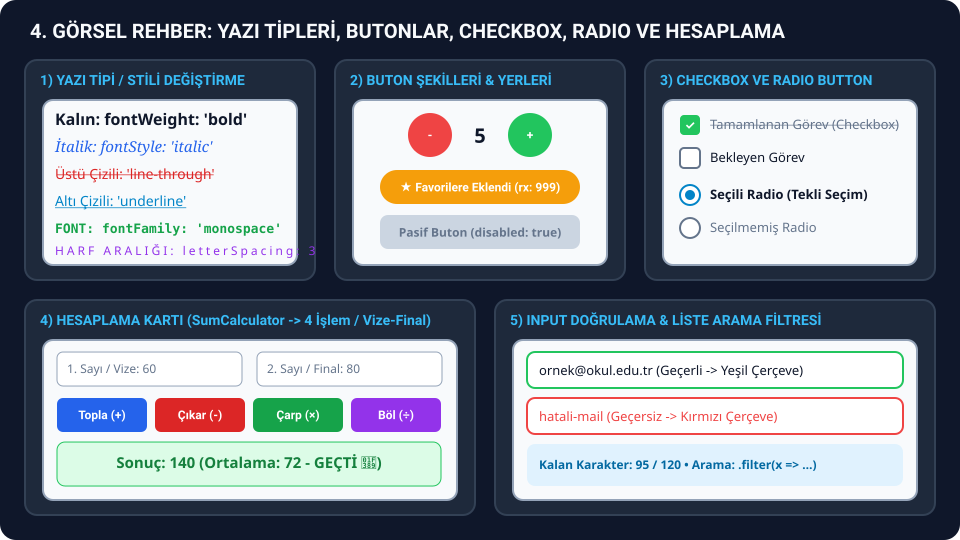

# 🎨 3. BÖLÜM: BUTON YERİ/RENGİ, YAZI TİPİ/STİLİ, YAZI EKLEME VE ETKİLEŞİMLİ KARTLAR

> **Sınavda Bu Dosyayı Ne Zaman Açacaksın?**
> Hoca görselde **yazı tipini (font), kalınlığını, italik/üstü çizili/altı çizili halini, rengini değiştirtirse**, **butona basınca ekrandaki yazıyı değiştirtirse veya yeni yazı ekletirse**, **butonların yerini (yan yana, alt alta, sağa/sola) veya rengini/şeklini değiştirtirse**, ya da **Favori Kartı, Açılır SSS Kartı, Adım Adım (Step) Kartı, Progress Bar Kartı** sorarsa doğrudan bu dosyayı kullan.
> Her senaryonun başında **hocanın bu konuyu hangi hafta (`W3`, `W4`, `W6`), hangi konu başlığı ve hangi fonksiyon adıyla işlediği** belirtilmiş; hem **hocanın dersteki orijinal kodu** hem de **sınavda isteyebileceği değiştirilmiş senaryo kodu** yorum satırsız olarak alt alta verilmiştir.



---

## 🎯 GÖRSELE BAK -> HANGİ HAFTANIN HANGİ KODUNU KULLANACAĞINI BUL

| Hocanın Verdiği Görselde Ne Görüyorsun? | İşlendiği Hafta & Konu Başlığı | Hocanın Kodundaki Karşılığı | Hangi Bölümü Kopyalayacaksın? |
| :--- | :--- | :--- | :--- |
| **Koyu ekranda büyük başlık, `Elapsed time`, 2 satırla sınırlı açıklama, sarı `Highlights` ve altı çizili link** | **W6** (`Text.md` -> `Example 1: Rich Text Banner Showcasing Props`) | `RichTextBanner()` | **Senaryo 1 -> Kod 1A** (Hocanın Orijinal Kodu) |
| **Ortada `Hello React Native 🚀`, altında `Platform: ios / android` ve açıklama yazısı** | **W4** (`2-example-hello-expo.md` -> `Basic App.js`) | `App()` | **Senaryo 1 -> Kod 1B** (Hocanın Orijinal Kodu) |
| **Butonlarla Yazı Rengi, Yazı Tipi (`serif`, `monospace`), Kalın (`bold`), İtalik, Üstü/Altı Çizili Değiştirme** | **W6** (`Text.md`) & **W3** (`12-styling.md` -> `InlineStyles`, `ThemeSystem`) | `Text` Stilleri + `useState` | **Senaryo 1 -> Kod 1C** (Sınav Senaryosu) |
| **Butona basınca başlığı değiştirme, `TextInput` ile ekrana yeni yazı ekleme, açıklamayı gizleme/gösterme** | **W4** (`5-react-native-state.md` & `6-react-native-hooks.md`) + **W3** (`07-conditional-rendering.md`) | `BasicConditional` & `TextInputExample` uyarlaması | **Senaryo 2** |
| **Sol kenarı renkli çizgili `Welcome / Success / Warning` mesaj kutuları** | **W4** (`4-react-native-props.md` -> `Example 1: Simple Message Component`) | `Message` & `App()` (`MessageExample.js`) | **Senaryo 3 -> Kod 3A** (Hocanın Orijinal Kodu) |
| **Alt alta `Blue Button`, `Green Button`, `Red Button`, `Disabled Button`** | **W4** (`4-react-native-props.md` -> `Example 2: Button Component`) | `CustomButton` & `ButtonExample()` | **Senaryo 3 -> Kod 3B** (Hocanın Orijinal Kodu) |
| **Koyu kart içinde Yıldızlı `Add to favorites / In favorites` hap butonu** | **W6** (`TouchableOpacity.md` -> `Example 1: Favorite Course Card`) | `CourseCard()` | **Senaryo 4 -> Kod 4A** (Hocanın Orijinal Kodu) |
| **Beyaz kart içinde sağında `+` / `−` olan açılır/kapanır soru-cevap (SSS) kutusu** | **W6** (`TouchableOpacity.md` -> `Example 2: FAQ Card with Expandable Content`) | `FAQItem()` | **Senaryo 4 -> Kod 4B** (Hocanın Orijinal Kodu) |
| **Koyu kart içinde `Daily Lesson Progress`, `+12%`, mavi doluluk çubuğu (`65%`) ve `13 / 20`** | **W6** (`View.md` -> `Example 1: Dashboard Card with Stats`) | `DashboardCard()` | **Senaryo 5 -> Kod 5A** (Hocanın Orijinal Kodu) |
| **`Step 1 / 3` yazan ve alttaki `Continue / Restart` butonuna basıldıkça ilerleyen ekran** | **W6** (`SafeAreaView.md` -> `Example 1: Onboarding Screen`) | `OnboardingScreen()` | **Senaryo 5 -> Kod 5B** (Hocanın Orijinal Kodu) |

---

## 🧩 SENARYO 1: Yazı Tipi (`fontFamily`), Rengi, Kalınlığı, İtalik ve Üstü/Altı Çizili Stil Değiştirme (`W6/Text.md` & `W4/2-example-hello-expo.md`)

### 📚 Ders Notlarındaki Karşılığı (Hafta / Konu / Kod Başlığı)
- **İşlendiği Haftalar:** **W4 (4. Hafta)** ve **W6 (6. Hafta)**
- **Konu Başlığı ve Dosya Adı:**
  - `W6 / components/Text.md` -> **`Example 1: Rich Text Banner Showcasing Props`** (`RichTextBanner` fonksiyonu)
  - `W4 / 2-example-hello-expo.md` -> **`Advanced Code Example -> Basic App.js`** (`App` fonksiyonu)

### 🔍 Kod 1A (Hocanın W6'daki Orijinal Ders Kodu): `RichTextBanner` (`Text.md - Example 1`)
- Hocanın W6 dersinde `<Text>` bileşeninin tüm özelliklerini (`fontSize: 30, fontWeight: '800'`, `textTransform: 'uppercase', letterSpacing: 2`, `numberOfLines={2}, ellipsizeMode="tail"`, iç içe `<Text>` ve `textDecorationLine: 'underline'`) gösterdiği orijinal koddur.

```jsx
import React, { useEffect, useMemo, useState } from 'react';
import { Linking, SafeAreaView, Text, View } from 'react-native';

const HIGHLIGHTS = [
  'Live coding',
  'Q&A',
  'Assignment review',
  'Release announcements',
];

export default function RichTextBanner() {
  const [seconds, setSeconds] = useState(0);

  useEffect(() => {
    const interval = setInterval(() => setSeconds((prev) => prev + 1), 1000);
    return () => clearInterval(interval);
  }, []);

  const highlights = useMemo(() => HIGHLIGHTS.join(' · '), []);

  return (
    <SafeAreaView style={{ flex: 1, backgroundColor: '#0f172a' }}>
      <View
        style={{
          flex: 1,
          justifyContent: 'center',
          padding: 24,
          gap: 16,
        }}
      >
        <Text
          style={{
            fontSize: 30,
            fontWeight: '800',
            color: '#f8fafc',
          }}
          selectable
        >
          Live React Native Session
        </Text>
        <Text
          style={{
            color: '#22d3ee',
            fontWeight: '600',
            textTransform: 'uppercase',
            letterSpacing: 2,
          }}
        >
          Elapsed time: {seconds}s
        </Text>
        <Text
          style={{
            color: '#94a3b8',
            lineHeight: 22,
          }}
          numberOfLines={2}
          ellipsizeMode="tail"
        >
          Every week we build real projects live, answer community questions,
          and explore the latest in React Native together.
        </Text>
        <Text
          style={{
            color: '#facc15',
            fontSize: 16,
            fontWeight: '600',
          }}
        >
          Highlights: <Text style={{ fontWeight: '400' }}>{highlights}</Text>
        </Text>
        <Text
          style={{
            color: '#38bdf8',
            textDecorationLine: 'underline',
            fontSize: 16,
          }}
          onPress={() => Linking.openURL('https://reactnative.dev/docs/text')}
        >
          Explore every Text prop in the docs
        </Text>
      </View>
    </SafeAreaView>
  );
}
```

### 🔍 Kod 1B (Hocanın W4'teki Orijinal Ders Kodu): `Basic App.js` (`2-example-hello-expo.md`)
- Hocanın W4 dersinde ilk Expo örneği olarak gösterdiği, ekranın tam ortasında başlık, platform bilgisi (`Platform.OS`, `Platform.Version`) ve açıklama metni içeren orijinal koddur.

```jsx
import React from 'react';
import { StatusBar } from 'expo-status-bar';
import { StyleSheet, Text, View, SafeAreaView, Platform } from 'react-native';

export default function App() {
  return (
    <SafeAreaView style={styles.container}>
      <View style={styles.content}>
        <Text style={styles.title}>Hello React Native 🚀</Text>
        <Text style={styles.subtitle}>
          Platform: {Platform.OS} {Platform.Version}
        </Text>
        <Text style={styles.description}>
          This app is created with Expo and works cross-platform.
        </Text>
      </View>
      <StatusBar style="auto" />
    </SafeAreaView>
  );
}

const styles = StyleSheet.create({
  container: {
    flex: 1,
    backgroundColor: '#f7fafc',
  },
  content: {
    flex: 1,
    alignItems: 'center',
    justifyContent: 'center',
    paddingHorizontal: 20,
  },
  title: {
    fontSize: 28,
    fontWeight: 'bold',
    color: '#2d3748',
    marginBottom: 16,
    textAlign: 'center',
  },
  subtitle: {
    fontSize: 16,
    color: '#4a5568',
    marginBottom: 12,
    fontWeight: '500',
  },
  description: {
    fontSize: 14,
    color: '#718096',
    textAlign: 'center',
    lineHeight: 20,
  },
});
```

### 🔍 Kod 1C (Sınav Senaryosu): Butonlarla Yazı Tipi (`fontFamily`), Rengi, Boyutu, Kalın, İtalik ve Üstü/Altı Çizili Değiştirici
- Hoca sınavda **"Butonlara basınca ortadaki yazının rengi, yazı tipi (fontu), kalınlığı, italikliği, üstü çizili olması ve büyüklüğü değişsin"** derse doğrudan bu kodu kullan.

```jsx
import React, { useState } from 'react';
import {
  SafeAreaView,
  ScrollView,
  View,
  Text,
  TouchableOpacity,
  StyleSheet,
} from 'react-native';

export default function YaziTipiVeStilDegistirici() {
  const [textColor, setTextColor] = useState('#0f172a');
  const [fontSize, setFontSize] = useState(22);
  const [isBold, setIsBold] = useState(true);
  const [isItalic, setIsItalic] = useState(false);
  const [decoration, setDecoration] = useState('none');
  const [fontFamily, setFontFamily] = useState('System');
  const [isUpper, setIsUpper] = useState(false);

  return (
    <SafeAreaView style={styles.safeArea}>
      <ScrollView contentContainerStyle={styles.container}>
        <Text style={styles.heading}>Yazı Tipi ve Stil Kontrolü</Text>

        <View style={styles.previewBox}>
          <Text
            style={{
              color: textColor,
              fontSize: fontSize,
              fontWeight: isBold ? 'bold' : 'normal',
              fontStyle: isItalic ? 'italic' : 'normal',
              textDecorationLine: decoration,
              fontFamily: fontFamily,
              textTransform: isUpper ? 'uppercase' : 'none',
              textAlign: 'center',
            }}
          >
            Mobil Uygulama Geliştirme Sınavı
          </Text>

          <Text style={styles.nestedExample}>
            Önemli Not:{' '}
            <Text style={styles.highlightedWord}>React Native</Text> ile{' '}
            <Text style={styles.underlinedWord}>Snack Expo</Text> uygulaması.
          </Text>
        </View>

        <Text style={styles.sectionLabel}>1. Yazı Rengi Seç:</Text>
        <View style={styles.row}>
          {[
            { label: 'Siyah', val: '#0f172a' },
            { label: 'Mavi', val: '#2563eb' },
            { label: 'Kırmızı', val: '#dc2626' },
            { label: 'Yeşil', val: '#16a34a' },
            { label: 'Mor', val: '#9333ea' },
          ].map((item) => (
            <TouchableOpacity
              key={item.val}
              onPress={() => setTextColor(item.val)}
              style={[styles.colorBtn, { backgroundColor: item.val }]}
            >
              <Text style={styles.btnText}>{item.label}</Text>
            </TouchableOpacity>
          ))}
        </View>

        <Text style={styles.sectionLabel}>2. Yazı Tipi (Font Family) Seç:</Text>
        <View style={styles.row}>
          {[
            { label: 'Standart', val: 'System' },
            { label: 'Serif (Tırnaklı)', val: 'serif' },
            { label: 'Monospace (Kod)', val: 'monospace' },
          ].map((item) => (
            <TouchableOpacity
              key={item.val}
              onPress={() => setFontFamily(item.val)}
              style={[
                styles.optionBtn,
                {
                  backgroundColor:
                    fontFamily === item.val ? '#2563eb' : '#334155',
                },
              ]}
            >
              <Text style={styles.btnText}>{item.label}</Text>
            </TouchableOpacity>
          ))}
        </View>

        <Text style={styles.sectionLabel}>3. Kalın, İtalik, Çizgili ve Harf Stili:</Text>
        <View style={styles.rowWrap}>
          <TouchableOpacity
            onPress={() => setIsBold(!isBold)}
            style={[
              styles.styleBtn,
              { backgroundColor: isBold ? '#16a34a' : '#64748b' },
            ]}
          >
            <Text style={styles.btnText}>Kalın (Bold)</Text>
          </TouchableOpacity>

          <TouchableOpacity
            onPress={() => setIsItalic(!isItalic)}
            style={[
              styles.styleBtn,
              { backgroundColor: isItalic ? '#16a34a' : '#64748b' },
            ]}
          >
            <Text style={styles.btnText}>İtalik</Text>
          </TouchableOpacity>

          <TouchableOpacity
            onPress={() =>
              setDecoration(
                decoration === 'line-through' ? 'none' : 'line-through'
              )
            }
            style={[
              styles.styleBtn,
              {
                backgroundColor:
                  decoration === 'line-through' ? '#dc2626' : '#64748b',
              },
            ]}
          >
            <Text style={styles.btnText}>Üstü Çizili</Text>
          </TouchableOpacity>

          <TouchableOpacity
            onPress={() =>
              setDecoration(decoration === 'underline' ? 'none' : 'underline')
            }
            style={[
              styles.styleBtn,
              {
                backgroundColor:
                  decoration === 'underline' ? '#0284c7' : '#64748b',
              },
            ]}
          >
            <Text style={styles.btnText}>Altı Çizili</Text>
          </TouchableOpacity>

          <TouchableOpacity
            onPress={() => setIsUpper(!isUpper)}
            style={[
              styles.styleBtn,
              { backgroundColor: isUpper ? '#9333ea' : '#64748b' },
            ]}
          >
            <Text style={styles.btnText}>BÜYÜK HARF</Text>
          </TouchableOpacity>
        </View>

        <Text style={styles.sectionLabel}>4. Yazı Boyutu ({fontSize}px):</Text>
        <View style={styles.row}>
          <TouchableOpacity
            onPress={() => setFontSize(fontSize - 2)}
            style={[styles.optionBtn, { backgroundColor: '#ef4444' }]}
          >
            <Text style={styles.btnText}>Yazıyı Küçült (-)</Text>
          </TouchableOpacity>
          <TouchableOpacity
            onPress={() => setFontSize(fontSize + 2)}
            style={[styles.optionBtn, { backgroundColor: '#22c55e' }]}
          >
            <Text style={styles.btnText}>Yazıyı Büyüt (+)</Text>
          </TouchableOpacity>
        </View>
      </ScrollView>
    </SafeAreaView>
  );
}

const styles = StyleSheet.create({
  safeArea: {
    flex: 1,
    backgroundColor: '#f8fafc',
  },
  container: {
    padding: 20,
    gap: 14,
  },
  heading: {
    fontSize: 22,
    fontWeight: 'bold',
    color: '#0f172a',
  },
  previewBox: {
    backgroundColor: '#ffffff',
    padding: 24,
    borderRadius: 16,
    borderWidth: 2,
    borderColor: '#cbd5e1',
    gap: 14,
    alignItems: 'center',
  },
  nestedExample: {
    fontSize: 15,
    color: '#475569',
    textAlign: 'center',
  },
  highlightedWord: {
    color: '#dc2626',
    fontWeight: 'bold',
  },
  underlinedWord: {
    color: '#2563eb',
    textDecorationLine: 'underline',
    fontWeight: '600',
  },
  sectionLabel: {
    fontSize: 15,
    fontWeight: 'bold',
    color: '#334155',
    marginTop: 4,
  },
  row: {
    flexDirection: 'row',
    gap: 8,
  },
  rowWrap: {
    flexDirection: 'row',
    flexWrap: 'wrap',
    gap: 8,
  },
  colorBtn: {
    flex: 1,
    paddingVertical: 10,
    borderRadius: 8,
    alignItems: 'center',
  },
  optionBtn: {
    flex: 1,
    paddingVertical: 12,
    borderRadius: 10,
    alignItems: 'center',
  },
  styleBtn: {
    paddingHorizontal: 14,
    paddingVertical: 10,
    borderRadius: 8,
  },
  btnText: {
    color: '#ffffff',
    fontWeight: 'bold',
    fontSize: 12,
  },
});
```

---

## 🧩 SENARYO 2: Yazı Değiştirme, Ekrana Yeni Yazı Ekleme ve Yazıyı Gizleme/Gösterme

### 📚 Ders Notlarındaki Karşılığı (Hafta / Konu / Kod Başlığı)
- **İşlendiği Haftalar:** **W3 (3. Hafta)** ve **W4 (4. Hafta)**
- **Konu Başlığı ve Dosya Adı:**
  - `W3 / 07-conditional-rendering.md` & `07-conditional-rendering-example.jsx` -> **`Basic Conditional Rendering` (`BasicConditional`)** ve **`Short Circuit Evaluation` (`ShortCircuitExample`)**
  - `W4 / 5-react-native-state.md` & `6-react-native-hooks.md` -> **`useState Hook`**

### 🔍 Bu Kod Bloğu Ne İşe Yarar?
- Butonlara basıldığında `title` state'ini değiştirerek başlık yazısını günceller.
- `showInfo` state'i ile açıklama kutusunu gizler veya gösterir (`{showInfo && ...}`).
- `inputText` ve `notes` state'leri ile kullanıcının yazdığı yeni maddeleri alt alta ekrana ekler (`setNotes([...notes, yeniMadde])`).

```jsx
import React, { useState } from 'react';
import {
  SafeAreaView,
  ScrollView,
  View,
  Text,
  TextInput,
  TouchableOpacity,
  StyleSheet,
} from 'react-native';

export default function YaziDegistirmeVeEkleme() {
  const [title, setTitle] = useState('Hoş Geldiniz!');
  const [showInfo, setShowInfo] = useState(true);
  const [inputText, setInputText] = useState('');
  const [notes, setNotes] = useState([
    '1. React Native bileşenlerini incele',
    '2. Flexbox düzenini uygula',
  ]);

  const addNote = () => {
    if (inputText.trim() === '') return;
    setNotes([...notes, `${notes.length + 1}. ${inputText.trim()}`]);
    setInputText('');
  };

  return (
    <SafeAreaView style={styles.safeArea}>
      <ScrollView contentContainerStyle={styles.container}>
        <View style={styles.card}>
          <Text style={styles.mainTitle}>{title}</Text>
          <View style={styles.buttonRow}>
            <TouchableOpacity
              style={[styles.actionBtn, { backgroundColor: '#2563eb' }]}
              onPress={() => setTitle('Merhaba React Native 🚀')}
            >
              <Text style={styles.btnText}>Başlığı Değiştir 1</Text>
            </TouchableOpacity>

            <TouchableOpacity
              style={[styles.actionBtn, { backgroundColor: '#16a34a' }]}
              onPress={() => setTitle('Sınav Başarıyla Tamamlandı 🎉')}
            >
              <Text style={styles.btnText}>Başlığı Değiştir 2</Text>
            </TouchableOpacity>
          </View>
        </View>

        <View style={styles.card}>
          <TouchableOpacity
            style={[
              styles.fullBtn,
              { backgroundColor: showInfo ? '#f97316' : '#0f172a' },
            ]}
            onPress={() => setShowInfo(!showInfo)}
          >
            <Text style={styles.btnText}>
              {showInfo ? 'Açıklama Yazısını Gizle' : 'Açıklama Yazısını Göster'}
            </Text>
          </TouchableOpacity>

          {showInfo && (
            <View style={styles.infoBanner}>
              <Text style={styles.infoBannerText}>
                Bu açıklama kutusu butona basıldığında görünür veya gizlenir.
              </Text>
            </View>
          )}
        </View>

        <View style={styles.card}>
          <Text style={styles.sectionTitle}>Yeni Yazı / Madde Ekle</Text>
          <View style={styles.inputRow}>
            <TextInput
              style={styles.input}
              placeholder="Eklenecek yazıyı girin..."
              value={inputText}
              onChangeText={setInputText}
            />
            <TouchableOpacity style={styles.addBtn} onPress={addNote}>
              <Text style={styles.btnText}>+ Ekle</Text>
            </TouchableOpacity>
          </View>

          {notes.map((note, index) => (
            <View key={index} style={styles.noteItem}>
              <Text style={styles.noteText}>{note}</Text>
            </View>
          ))}
        </View>
      </ScrollView>
    </SafeAreaView>
  );
}

const styles = StyleSheet.create({
  safeArea: {
    flex: 1,
    backgroundColor: '#f1f5f9',
  },
  container: {
    padding: 20,
    gap: 16,
  },
  card: {
    backgroundColor: '#ffffff',
    padding: 18,
    borderRadius: 16,
    gap: 12,
    borderWidth: 1,
    borderColor: '#e2e8f0',
  },
  mainTitle: {
    fontSize: 22,
    fontWeight: 'bold',
    color: '#0f172a',
    textAlign: 'center',
  },
  sectionTitle: {
    fontSize: 18,
    fontWeight: 'bold',
    color: '#0f172a',
  },
  buttonRow: {
    flexDirection: 'row',
    gap: 10,
  },
  actionBtn: {
    flex: 1,
    paddingVertical: 12,
    borderRadius: 10,
    alignItems: 'center',
  },
  fullBtn: {
    paddingVertical: 12,
    borderRadius: 10,
    alignItems: 'center',
  },
  btnText: {
    color: '#ffffff',
    fontWeight: 'bold',
    fontSize: 13,
  },
  infoBanner: {
    backgroundColor: '#fef3c7',
    padding: 14,
    borderRadius: 10,
    borderLeftWidth: 4,
    borderLeftColor: '#f59e0b',
  },
  infoBannerText: {
    color: '#92400e',
    fontSize: 14,
    fontWeight: '600',
  },
  inputRow: {
    flexDirection: 'row',
    gap: 8,
  },
  input: {
    flex: 1,
    borderWidth: 1,
    borderColor: '#cbd5e1',
    borderRadius: 10,
    paddingHorizontal: 12,
    paddingVertical: 10,
  },
  addBtn: {
    backgroundColor: '#2563eb',
    paddingHorizontal: 18,
    justifyContent: 'center',
    borderRadius: 10,
  },
  noteItem: {
    backgroundColor: '#f8fafc',
    padding: 12,
    borderRadius: 8,
    borderWidth: 1,
    borderColor: '#e2e8f0',
  },
  noteText: {
    fontSize: 15,
    color: '#334155',
  },
});
```

---

## 🧩 SENARYO 3: Sol Çizgili Mesaj Kartları (`MessageExample`) ve Özelleştirilebilir Renkli Butonlar (`ButtonExample`)

### 📚 Ders Notlarındaki Karşılığı (Hafta / Konu / Kod Başlığı)
- **İşlendiği Hafta:** **W4 (4. Hafta)**
- **Konu Başlığı ve Dosya Adı:**
  - `W4 / 4-react-native-props.md` -> **`Basic Props Usage -> Example 1: Simple Message Component`** (`MessageExample.js` / `Message` bileşeni)
  - `W4 / 4-react-native-props.md` -> **`Example 2: Button Component`** (`ButtonExample.js` / `CustomButton` bileşeni)

### 🔍 Kod 3A (Hocanın W4'teki Orijinal Ders Kodu 1): `MessageExample` (`4-react-native-props.md - Example 1`)
- Hocanın W4 dersinde `Message` bileşenine `title`, `message` ve `color` prop'larını göndererek Mavi (`Welcome`), Yeşil (`Success`) ve Sarı (`Warning`) kartlar oluşturduğu orijinal koddur.

```jsx
import React from 'react';
import { View, Text, StyleSheet } from 'react-native';

function Message({ title, message, color }) {
  return (
    <View style={[styles.container, { borderLeftColor: color }]}>
      <Text style={[styles.title, { color }]}>{title}</Text>
      <Text style={styles.message}>{message}</Text>
    </View>
  );
}

export default function App() {
  return (
    <View style={styles.app}>
      <Message
        title="Welcome"
        message="You are learning React Native!"
        color="#007AFF"
      />

      <Message
        title="Success"
        message="You learned props usage!"
        color="#28A745"
      />

      <Message
        title="Warning"
        message="Props are read-only!"
        color="#FFC107"
      />
    </View>
  );
}

const styles = StyleSheet.create({
  app: {
    flex: 1,
    padding: 20,
    justifyContent: 'center',
  },
  container: {
    backgroundColor: '#f8f9fa',
    padding: 20,
    borderRadius: 10,
    marginBottom: 15,
    borderLeftWidth: 4,
  },
  title: {
    fontSize: 18,
    fontWeight: 'bold',
    marginBottom: 8,
  },
  message: {
    fontSize: 14,
    color: '#666666',
  },
});
```

### 🔍 Kod 3B (Hocanın W4'teki Orijinal Ders Kodu 2): `ButtonExample` (`4-react-native-props.md - Example 2`)
- Hocanın W4 dersinde `CustomButton` bileşenine `title`, `onPress`, `color` ve `disabled` prop'larını göndererek Mavi, Yeşil, Kırmızı ve Pasif (Gri) butonlar oluşturduğu orijinal koddur.

```jsx
import React from 'react';
import { View, TouchableOpacity, Text, StyleSheet } from 'react-native';

function CustomButton({ title, onPress, color = '#007AFF', disabled = false }) {
  return (
    <TouchableOpacity
      style={[
        styles.button,
        { backgroundColor: disabled ? '#cccccc' : color },
      ]}
      onPress={onPress}
      disabled={disabled}
    >
      <Text style={styles.buttonText}>{title}</Text>
    </TouchableOpacity>
  );
}

export default function ButtonExample() {
  const handlePress = () => {
    alert('Button clicked!');
  };

  return (
    <View style={styles.container}>
      <Text style={styles.title}>Button Examples</Text>

      <CustomButton
        title="Blue Button"
        onPress={handlePress}
        color="#007AFF"
      />

      <CustomButton
        title="Green Button"
        onPress={handlePress}
        color="#28A745"
      />

      <CustomButton
        title="Red Button"
        onPress={handlePress}
        color="#DC3545"
      />

      <CustomButton
        title="Disabled Button"
        onPress={handlePress}
        color="#007AFF"
        disabled={true}
      />
    </View>
  );
}

const styles = StyleSheet.create({
  container: {
    flex: 1,
    padding: 20,
    justifyContent: 'center',
  },
  title: {
    fontSize: 24,
    fontWeight: 'bold',
    textAlign: 'center',
    marginBottom: 30,
    color: '#333333',
  },
  button: {
    padding: 15,
    borderRadius: 8,
    marginBottom: 15,
    alignItems: 'center',
  },
  buttonText: {
    color: '#ffffff',
    fontSize: 16,
    fontWeight: '600',
  },
});
```

---

## 🧩 SENARYO 4: Favori Yıldız Butonu Kartı (`CourseCard`) ve Açılır/Kapanır SSS Kartı (`FAQItem`)

### 📚 Ders Notlarındaki Karşılığı (Hafta / Konu / Kod Başlığı)
- **İşlendiği Hafta:** **W6 (6. Hafta)**
- **Konu Başlığı ve Dosya Adı:**
  - `W6 / components/TouchableOpacity.md` -> **`Example 1: Favorite Course Card`** (`CourseCard` fonksiyonu)
  - `W6 / components/TouchableOpacity.md` -> **`Example 2: FAQ Card with Expandable Content`** (`FAQItem` fonksiyonu)

### 🔍 Kod 4A (Hocanın W6'daki Orijinal Ders Kodu 1): `CourseCard` (`TouchableOpacity.md - Example 1`)
- Tıklandığında `isFavorite` state'ini değiştiren, arka plan rengi `#334155` ile `#f59e0b` arasında geçiş yapan ve `Ionicons` yıldız ikonunu (`star` / `star-outline`) güncelleyen orijinal ders kodudur.

```jsx
import React, { useState } from 'react';
import { SafeAreaView, Text, TouchableOpacity, View } from 'react-native';
import { Ionicons } from '@expo/vector-icons';

export default function CourseCard() {
  const [isFavorite, setFavorite] = useState(false);
  const courseTitle = 'React Native Core Components';

  return (
    <SafeAreaView style={{ flex: 1, backgroundColor: '#0f172a' }}>
      <View
        style={{
          flex: 1,
          justifyContent: 'center',
          padding: 24,
        }}
      >
        <View
          style={{
            padding: 24,
            borderRadius: 20,
            backgroundColor: '#1f2937',
            gap: 16,
          }}
        >
          <Text style={{ color: '#f8fafc', fontSize: 20, fontWeight: '700' }}>
            {courseTitle}
          </Text>
          <Text style={{ color: '#cbd5e1', lineHeight: 20 }}>
            Add this course to your favorites for quick access and get notified
            when new lessons drop.
          </Text>
          <TouchableOpacity
            onPress={() => setFavorite((prev) => !prev)}
            activeOpacity={0.7}
            style={{
              alignSelf: 'flex-start',
              flexDirection: 'row',
              gap: 8,
              paddingVertical: 10,
              paddingHorizontal: 16,
              borderRadius: 999,
              backgroundColor: isFavorite ? '#f59e0b' : '#334155',
            }}
          >
            <Ionicons
              name={isFavorite ? 'star' : 'star-outline'}
              size={18}
              color="#fef3c7"
            />
            <Text style={{ color: '#fef3c7', fontWeight: '600' }}>
              {isFavorite ? 'In favorites' : 'Add to favorites'}
            </Text>
          </TouchableOpacity>
        </View>
      </View>
    </SafeAreaView>
  );
}
```

### 🔍 Kod 4B (Hocanın W6'daki Orijinal Ders Kodu 2): `FAQItem` (`TouchableOpacity.md - Example 2`)
- Soru satırına tıklandığında `expanded` state'ini değiştiren, sağdaki `+` işaretini `−` yapan ve altındaki cevabı (`ANSWER`) gösteren orijinal ders kodudur.

```jsx
import React, { useState } from 'react';
import { SafeAreaView, Text, TouchableOpacity, View } from 'react-native';

const QUESTION = 'How do I share my project with Expo?';
const ANSWER =
  'You can either scan the QR code in the Expo Go app or publish the project with the expo publish command.';

export default function FAQItem() {
  const [expanded, setExpanded] = useState(false);

  return (
    <SafeAreaView style={{ flex: 1, backgroundColor: '#f8fafc' }}>
      <View
        style={{
          flex: 1,
          justifyContent: 'center',
          padding: 24,
        }}
      >
        <View
          style={{
            borderRadius: 16,
            backgroundColor: '#ffffff',
            shadowColor: '#000000',
            shadowOpacity: 0.04,
            shadowRadius: 12,
            elevation: 2,
          }}
        >
          <TouchableOpacity
            onPress={() => setExpanded((prev) => !prev)}
            activeOpacity={0.6}
            style={{
              padding: 20,
              flexDirection: 'row',
              justifyContent: 'space-between',
              alignItems: 'center',
            }}
          >
            <Text style={{ fontWeight: '600', flex: 1, fontSize: 16 }}>
              {QUESTION}
            </Text>
            <Text style={{ color: '#2563eb', marginLeft: 16, fontSize: 18 }}>
              {expanded ? '−' : '+'}
            </Text>
          </TouchableOpacity>
          {expanded && (
            <View style={{ paddingHorizontal: 20, paddingBottom: 20 }}>
              <Text style={{ color: '#475569', lineHeight: 20 }}>{ANSWER}</Text>
            </View>
          )}
        </View>
      </View>
    </SafeAreaView>
  );
}
```

---

## 🧩 SENARYO 5: İlerleme Çubuğu Kartı (`DashboardCard`) ve Adım Adım Tanıtım Ekranı (`OnboardingScreen`)

### 📚 Ders Notlarındaki Karşılığı (Hafta / Konu / Kod Başlığı)
- **İşlendiği Hafta:** **W6 (6. Hafta)**
- **Konu Başlığı ve Dosya Adı:**
  - `W6 / components/View.md` -> **`Example 1: Dashboard Card with Stats`** (`DashboardCard` fonksiyonu)
  - `W6 / components/SafeAreaView.md` -> **`Example 1: Onboarding Screen`** (`OnboardingScreen` fonksiyonu)

### 🔍 Kod 5A (Hocanın W6'daki Orijinal Ders Kodu 1): `DashboardCard` (`View.md - Example 1`)
- Hocanın W6 dersinde `flexDirection: 'row', justifyContent: 'space-between'` ve iç içe iki `<View>` ile `%65` dolu ilerleme çubuğu (`width: '65%'`) oluşturduğu orijinal koddur.

```jsx
import React from 'react';
import { SafeAreaView, View, Text } from 'react-native';

export default function DashboardCard() {
  return (
    <SafeAreaView style={{ flex: 1, backgroundColor: '#020617' }}>
      <View
        style={{
          flex: 1,
          justifyContent: 'center',
          padding: 24,
        }}
      >
        <View
          style={{
            padding: 24,
            borderRadius: 20,
            backgroundColor: '#0f172a',
            gap: 20,
          }}
        >
          <View
            style={{ flexDirection: 'row', justifyContent: 'space-between' }}
          >
            <Text style={{ color: '#e2e8f0', fontSize: 18, fontWeight: '600' }}>
              Daily Lesson Progress
            </Text>
            <Text style={{ color: '#38bdf8', fontWeight: '600' }}>+12%</Text>
          </View>
          <View
            style={{
              height: 8,
              borderRadius: 8,
              backgroundColor: '#1e293b',
            }}
          >
            <View
              style={{
                width: '65%',
                height: '100%',
                borderRadius: 8,
                backgroundColor: '#38bdf8',
              }}
            />
          </View>
          <View
            style={{ flexDirection: 'row', justifyContent: 'space-between' }}
          >
            <Text style={{ color: '#94a3b8' }}>Lessons completed</Text>
            <Text style={{ color: '#e2e8f0', fontWeight: '600' }}>13 / 20</Text>
          </View>
        </View>
      </View>
    </SafeAreaView>
  );
}
```

### 🔍 Kod 5B (Hocanın W6'daki Orijinal Ders Kodu 2): `OnboardingScreen` (`SafeAreaView.md - Example 1`)
- Hocanın W6 dersinde `STEPS` dizisindeki 3 adımı sırayla gösteren, son adımda (`lastStep`) buton rengini `#38bdf8` (Mavi) yerine `#22c55e` (Yeşil) ve buton yazısını `'Continue'` yerine `'Restart'` yapan orijinal koddur.

```jsx
import React, { useState } from 'react';
import {
  SafeAreaView,
  StatusBar,
  Text,
  TouchableOpacity,
  View,
} from 'react-native';

const STEPS = [
  {
    title: 'Welcome to the React Native Course',
    description:
      'You will learn core components, navigation, and state management step by step.',
  },
  {
    title: 'Discover Core Components',
    description:
      'Practice building layouts with View, Text, Image, and more.',
  },
  {
    title: 'Kick Off with Expo',
    description:
      'Run expo start to launch the project and test on your device in real time.',
  },
];

export default function OnboardingScreen() {
  const [step, setStep] = useState(0);
  const lastStep = step === STEPS.length - 1;

  const handleNext = () => {
    if (lastStep) {
      setStep(0);
      return;
    }
    setStep((prev) => prev + 1);
  };

  return (
    <SafeAreaView style={{ flex: 1, backgroundColor: '#0f172a' }}>
      <StatusBar barStyle="light-content" />
      <View style={{ flex: 1, justifyContent: 'space-between', padding: 24 }}>
        <View style={{ gap: 16 }}>
          <Text style={{ color: '#38bdf8', fontSize: 16, fontWeight: '600' }}>
            Step {step + 1} / {STEPS.length}
          </Text>
          <Text style={{ color: '#f8fafc', fontSize: 30, fontWeight: '700' }}>
            {STEPS[step].title}
          </Text>
          <Text style={{ color: '#cbd5e1', lineHeight: 22 }}>
            {STEPS[step].description}
          </Text>
        </View>
        <View style={{ gap: 12 }}>
          {lastStep && (
            <Text style={{ color: '#94a3b8', textAlign: 'center' }}>
              You’re ready! Restart the flow any time you need a refresher.
            </Text>
          )}
          <TouchableOpacity
            onPress={handleNext}
            activeOpacity={0.8}
            style={{
              paddingVertical: 16,
              borderRadius: 12,
              backgroundColor: lastStep ? '#22c55e' : '#38bdf8',
              alignItems: 'center',
            }}
          >
            <Text style={{ color: '#0f172a', fontWeight: '700' }}>
              {lastStep ? 'Restart' : 'Continue'}
            </Text>
          </TouchableOpacity>
        </View>
      </View>
    </SafeAreaView>
  );
}
```
