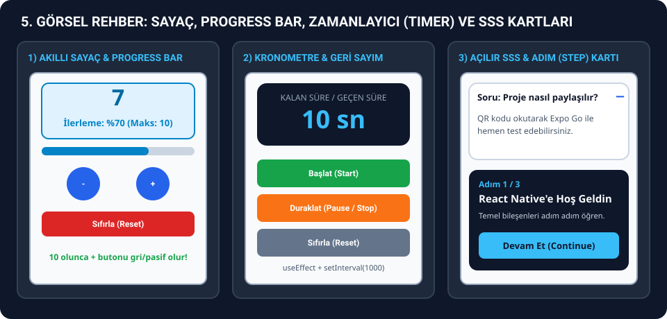

# ⏱️ 4. BÖLÜM: SAYAÇLAR, ZAMANLAYICILAR (TIMER), `useState` VE `useEffect` REHBERİ (W2 – W6 DERS KODLARI KARŞILIKLARIYLA)

> **Sınavda Bu Dosyayı Ne Zaman Açacaksın?**
> Hoca sınavda **artırma/azaltma/sıfırlama sayacı (`+`, `-`, `Reset`)**, **0 ile 10 arasında sınırlı ve yüzde ilerlemeli sayaç**, **sabit değişken bilgi kartları (`VariableExample`)**, **5 kez tıklayınca uyarı (`Alert`) veren buton**, **ileri sayan kronometre (`Start`, `Stop`, `Reset`)**, **10'dan geriye sayan sayaç (`Countdown`)** veya **sayfa açıldıktan 2 saniye sonra değişen yazı (`useEffect`)** sorduğunda bu dosyayı aç.
>
> **Bu Dosyada Neler Var?**
> 1. Her görsel senaryonun **hangi haftada (`W2`, `W3`, `W4`, `W6`)**, **hangi ders dosyasında**, **hangi konu başlığında** ve **hangi fonksiyon adıyla** işlendiği tablosu.
> 2. Hocanın ders notlarındaki **birebir aynı orijinal örnek kodların temiz (yorum satırsız) hali**.
> 3. Sınavda hocanın değiştirmesini isteyeceği **geliştirilmiş sınav senaryosu kodları**.



---

## 🎯 GÖRSELE BAK -> HANGİ HAFTA, HANGİ KONU BAŞLIĞI VE HANGİ KOD?

| Hocanın Verdiği Görselde Ne Görüyorsun? | İşlendiği Hafta ve Dosya | Ders Notundaki Konu Başlığı ve Kod Adı | Hangi Bölüme Bakacaksın? |
| :--- | :--- | :--- | :--- |
| **Ortada büyük sayı, altında yan yana yuvarlak `-` ve `+` butonları, en altta `Reset` (veya `Increment` / `Decrement`)** | **W4** (`5-react-native-state.md` & `6-react-native-hooks.md`) / **W3** (`04-state-example.jsx`) | `State Management with useState Hook -> Example 1: Simple Counter` (`SimpleCounter`) & `1. useState Hook -> Example 1: Simple Counter` (`Counter`) | **Senaryo 1** |
| **Kutuda sayı + `Progress: %...` yazısı + 10'a ulaşınca `🎉 You reached maximum value!` yazısı veya sol şeritli değişken bilgi kutuları** | **W4** (`3-react-native-variable-const.md`) / **W2** (`03_variables_constants.js` & `06_control_flow.js`) | `Example 1: Simple Variable Usage` (`VariableExample`) & `Example 2: Dynamic Variable Usage` (`DynamicVariableExample`) | **Senaryo 2** |
| **`Click Count: X` yazan mavi buton + 5 kez tıklayınca `Alert` penceresi + Uzun basınca `Platform` bilgisi** | **W4** (`2-example-hello-expo.md`) | `Advanced Code Example -> Basic App.js` & `Interactive Version` (`App` - `handlePress`, `handleLongPress`) | **Senaryo 3** |
| **`0 seconds` yazısı ve altında Yeşil `Start`, Kırmızı `Stop`, Gri `Reset` butonları** | **W4** (`6-react-native-hooks.md`) / **W3** (`05-lifecycle-and-effects-example.jsx`) | `2. useEffect Hook -> Example 2: Timer` (`Timer`) & `3. Effect with Cleanup (Timer)` (`TimerExample`) | **Senaryo 4** |
| **Koyu ekranda `10s` geri sayımı ve altında `Start / Pause` + `Reset` butonları** | **W6** (`components/Button.md`) | `Example 2: Countdown Start/Pause Buttons` (`CountdownController`) | **Senaryo 5** |
| **Önce `Loading...` yazıp 2 saniye sonra `Welcome!` olan ekran veya canlı süre sayan `Elapsed time: Xs` başlığı** | **W4** (`6-react-native-hooks.md`) & **W6** (`components/Text.md`) | `2. useEffect Hook -> Example 1: Message on Page Load` (`WelcomeMessage`) & `Example 1: Rich Text Banner Showcasing Props` (`RichTextBanner`) | **Senaryo 6** |

---

## 🧩 SENARYO 1: Klasik Sayaç (`+`, `-`, `Reset`) ve Sayının Durumuna Göre Renk Değişimi

> ### 📌 Ders Notu Karşılığı (Hangi Hafta / Hangi Dosya / Hangi Konu Başlığı?)
> - **4. Hafta (`W4/5-react-native-state.md`):** `State Management with useState Hook -> Example 1: Simple Counter` başlığındaki **`SimpleCounter`** bileşeni (Yuvarlak `-` ve `+` butonları yan yana, altında kırmızı `Reset` butonu).
> - **4. Hafta (`W4/6-react-native-hooks.md`):** `Basic Hooks -> 1. useState Hook -> Example 1: Simple Counter` başlığındaki **`Counter`** bileşeni (Alt alta `Increment` ve `Decrement` butonları).
> - **3. Hafta (`W3/04-state-example.jsx`):** `1. Simple State` başlığındaki **`Counter`** bileşeni (`count`, `setCount(count + 1)`, `setCount(count - 1)`, `setCount(0)`).

### 🔹 1A. Hocanın 4. Hafta `W4/5-react-native-state.md` Dosyasındaki Orijinal `SimpleCounter` Kodu
**Kodun Üstü Açıklama:**
- Hocanın 4. haftada `useState` anlatırken kullandığı ilk sayaç kodudur.
- `count` state'i `0` ile başlar; `increment` 1 artırır, `decrement` 1 azaltır, `reset` sıfırlar.
- `-` ve `+` butonları `buttonContainer` (`flexDirection: 'row'`) içinde yan yana yuvarlak (`borderRadius: 50`) olarak dizilmiştir.

```jsx
import React, { useState } from 'react';
import { View, Text, TouchableOpacity, StyleSheet } from 'react-native';

export default function SimpleCounter() {
  const [count, setCount] = useState(0);

  const increment = () => {
    setCount(count + 1);
  };

  const decrement = () => {
    setCount(count - 1);
  };

  const reset = () => {
    setCount(0);
  };

  return (
    <View style={styles.container}>
      <Text style={styles.title}>Simple Counter</Text>
      <Text style={styles.countText}>{count}</Text>

      <View style={styles.buttonContainer}>
        <TouchableOpacity style={styles.button} onPress={decrement}>
          <Text style={styles.buttonText}>-</Text>
        </TouchableOpacity>

        <TouchableOpacity style={styles.button} onPress={increment}>
          <Text style={styles.buttonText}>+</Text>
        </TouchableOpacity>
      </View>

      <TouchableOpacity style={styles.resetButton} onPress={reset}>
        <Text style={styles.buttonText}>Reset</Text>
      </TouchableOpacity>
    </View>
  );
}

const styles = StyleSheet.create({
  container: {
    flex: 1,
    justifyContent: 'center',
    alignItems: 'center',
    padding: 20,
  },
  title: {
    fontSize: 24,
    fontWeight: 'bold',
    marginBottom: 20,
    color: '#333',
  },
  countText: {
    fontSize: 48,
    fontWeight: 'bold',
    marginBottom: 30,
    color: '#007AFF',
  },
  buttonContainer: {
    flexDirection: 'row',
    marginBottom: 20,
  },
  button: {
    backgroundColor: '#007AFF',
    padding: 20,
    borderRadius: 50,
    margin: 10,
    minWidth: 60,
    alignItems: 'center',
  },
  resetButton: {
    backgroundColor: '#DC3545',
    padding: 15,
    borderRadius: 8,
    minWidth: 100,
    alignItems: 'center',
  },
  buttonText: {
    color: 'white',
    fontSize: 20,
    fontWeight: 'bold',
  },
});
```

### 🔹 1B. Hocanın 4. Hafta `W4/6-react-native-hooks.md` Dosyasındaki Orijinal `Counter` Kodu
**Kodun Üstü Açıklama:**
- Hocanın `W4/6-react-native-hooks.md` dosyasında `1. useState Hook -> Example 1: Simple Counter` başlığı altında işlediği koddur.
- Ekranda `Counter: 0` yazar ve altında alt alta mavi `Increment` ve `Decrement` butonları bulunur.

```jsx
import React, { useState } from 'react';
import { View, Text, TouchableOpacity, StyleSheet } from 'react-native';

export default function Counter() {
  const [count, setCount] = useState(0);

  return (
    <View style={styles.container}>
      <Text style={styles.countText}>Counter: {count}</Text>

      <TouchableOpacity
        style={styles.button}
        onPress={() => setCount(count + 1)}
      >
        <Text style={styles.buttonText}>Increment</Text>
      </TouchableOpacity>

      <TouchableOpacity
        style={styles.button}
        onPress={() => setCount(count - 1)}
      >
        <Text style={styles.buttonText}>Decrement</Text>
      </TouchableOpacity>
    </View>
  );
}

const styles = StyleSheet.create({
  container: {
    flex: 1,
    justifyContent: 'center',
    alignItems: 'center',
    padding: 20,
  },
  countText: {
    fontSize: 24,
    marginBottom: 20,
    fontWeight: 'bold',
  },
  button: {
    backgroundColor: '#007AFF',
    padding: 15,
    borderRadius: 8,
    margin: 10,
    minWidth: 100,
    alignItems: 'center',
  },
  buttonText: {
    color: 'white',
    fontSize: 16,
    fontWeight: '600',
  },
});
```

### 🔹 1C. Sınav Senaryosu: Tek / Çift / Negatif Durumuna Göre Renk Değiştiren ve Adım Miktarı Seçilebilen Sayaç
**Kodun Üstü Açıklama:**
- Hocanın `SimpleCounter` örneğine sınavda **"Sayı çiftse Mavi, tekse Turuncu, sıfırdan küçükse Kırmızı olsun; ayrıca +1 / +5 artırma seçeneği olsun"** şeklinde yaptırabileceği değişikliklerin hazır halidir.

```jsx
import React, { useState } from 'react';
import {
  SafeAreaView,
  View,
  Text,
  TouchableOpacity,
  StyleSheet,
} from 'react-native';

export default function RenkliSinavSayaci() {
  const [count, setCount] = useState(0);

  const increment = () => {
    setCount(count + 1);
  };

  const decrement = () => {
    setCount(count - 1);
  };

  const reset = () => {
    setCount(0);
  };

  const dynamicColor =
    count < 0 ? '#DC3545' : count % 2 === 0 ? '#007AFF' : '#f97316';

  return (
    <SafeAreaView style={styles.safeArea}>
      <View style={styles.container}>
        <Text style={styles.title}>Simple Counter</Text>
        <Text style={[styles.countText, { color: dynamicColor }]}>{count}</Text>
        <Text style={styles.parityText}>
          Durum: {count < 0 ? 'Negatif Sayı' : count % 2 === 0 ? 'Çift Sayı' : 'Tek Sayı'}
        </Text>

        <View style={styles.buttonContainer}>
          <TouchableOpacity style={styles.button} onPress={decrement}>
            <Text style={styles.buttonText}>-</Text>
          </TouchableOpacity>

          <TouchableOpacity style={styles.button} onPress={increment}>
            <Text style={styles.buttonText}>+</Text>
          </TouchableOpacity>
        </View>

        <TouchableOpacity style={styles.resetButton} onPress={reset}>
          <Text style={styles.buttonText}>Reset</Text>
        </TouchableOpacity>
      </View>
    </SafeAreaView>
  );
}

const styles = StyleSheet.create({
  safeArea: {
    flex: 1,
    backgroundColor: '#ffffff',
  },
  container: {
    flex: 1,
    justifyContent: 'center',
    alignItems: 'center',
    padding: 20,
  },
  title: {
    fontSize: 24,
    fontWeight: 'bold',
    marginBottom: 16,
    color: '#333333',
  },
  countText: {
    fontSize: 56,
    fontWeight: 'bold',
    marginBottom: 8,
  },
  parityText: {
    fontSize: 15,
    color: '#64748b',
    marginBottom: 24,
    fontWeight: '600',
  },
  buttonContainer: {
    flexDirection: 'row',
    marginBottom: 20,
  },
  button: {
    backgroundColor: '#007AFF',
    padding: 20,
    borderRadius: 50,
    margin: 10,
    minWidth: 64,
    alignItems: 'center',
  },
  resetButton: {
    backgroundColor: '#DC3545',
    padding: 15,
    borderRadius: 8,
    minWidth: 120,
    alignItems: 'center',
  },
  buttonText: {
    color: '#ffffff',
    fontSize: 20,
    fontWeight: 'bold',
  },
});
```

---

## 🧩 SENARYO 2: Sabit Değişken Bilgi Kartları (`VariableExample`) ve 0-10 Sınırlı Yüzde İlerlemeli Akıllı Sayaç (`DynamicVariableExample`)

> ### 📌 Ders Notu Karşılığı (Hangi Hafta / Hangi Dosya / Hangi Konu Başlığı?)
> - **4. Hafta (`W4/3-react-native-variable-const.md`):**
>   - `Example 1: Simple Variable Usage` başlığındaki **`VariableExample`** bileşeni (`const appName`, `const version`, `let userCount`, `let isOnline`).
>   - `Example 2: Dynamic Variable Usage` başlığındaki **`DynamicVariableExample`** bileşeni (`maxCount = 10`, `minCount = 0`, `stepSize = 1`, `progress`, `isComplete`).
> - **2. Hafta (`W2/03_variables_constants.js` & `W2/06_control_flow.js`):** `const` / `let` tanımlamaları ve `if (canIncrement)` koşul kontrolü.

### 🔹 2A. Hocanın 4. Hafta `W4/3-react-native-variable-const.md` Dosyasındaki Orijinal `VariableExample` Kodu
**Kodun Üstü Açıklama:**
- Hocanın 4. haftada `const` ve `let` farkını göstermek için yazdığı ilk koddur.
- Sol kenarı mavi çizgili (`borderLeftWidth: 4, borderLeftColor: '#007AFF'`) 4 adet bilgi kutusu (`infoBox`) içinde uygulama adı, versiyon, kullanıcı sayısı ve çevrimiçi durumunu (`isOnline ? 'Yes' : 'No'`) gösterir.

```jsx
import React from 'react';
import { View, Text, StyleSheet } from 'react-native';

export default function VariableExample() {
  const appName = 'React Native Application';
  const version = '1.0.0';

  let userCount = 0;
  let isOnline = true;

  userCount = userCount + 1;
  isOnline = false;

  return (
    <View style={styles.container}>
      <Text style={styles.title}>Variable Example</Text>

      <View style={styles.infoBox}>
        <Text style={styles.label}>App Name:</Text>
        <Text style={styles.value}>{appName}</Text>
      </View>

      <View style={styles.infoBox}>
        <Text style={styles.label}>Version:</Text>
        <Text style={styles.value}>{version}</Text>
      </View>

      <View style={styles.infoBox}>
        <Text style={styles.label}>User Count:</Text>
        <Text style={styles.value}>{userCount}</Text>
      </View>

      <View style={styles.infoBox}>
        <Text style={styles.label}>Online:</Text>
        <Text style={styles.value}>{isOnline ? 'Yes' : 'No'}</Text>
      </View>
    </View>
  );
}

const styles = StyleSheet.create({
  container: {
    flex: 1,
    padding: 20,
    justifyContent: 'center',
  },
  title: {
    fontSize: 24,
    fontWeight: 'bold',
    textAlign: 'center',
    marginBottom: 30,
    color: '#333',
  },
  infoBox: {
    backgroundColor: '#f8f9fa',
    padding: 15,
    borderRadius: 8,
    marginBottom: 10,
    borderLeftWidth: 4,
    borderLeftColor: '#007AFF',
  },
  label: {
    fontSize: 14,
    color: '#666',
    marginBottom: 5,
  },
  value: {
    fontSize: 16,
    fontWeight: '600',
    color: '#333',
  },
});
```

### 🔹 2B. Hocanın 4. Hafta `W4/3-react-native-variable-const.md` Dosyasındaki Orijinal `DynamicVariableExample` Kodu
**Kodun Üstü Açıklama:**
- Hocanın `W4/3-react-native-variable-const.md` dosyasındaki ikinci örnek olan **`DynamicVariableExample`** kodunun birebir (yorum satırsız) halidir.
- Sayı `0` olduğunda `-` butonu grileşir (`disabledButton`), sayı `10` olduğunda `+` butonu grileşir ve ekranda yeşil `🎉 You reached maximum value!` yazısı çıkar.
- **Sınav İpucu:** Hoca maksimum sayıyı `20`, artış miktarını `2` yapmanızı isterse sadece üstteki `const maxCount = 20;` ve `const stepSize = 2;` satırlarını değiştirmeniz yeterlidir!

```jsx
import React, { useState } from 'react';
import { View, Text, TouchableOpacity, StyleSheet } from 'react-native';

export default function DynamicVariableExample() {
  const [count, setCount] = useState(0);

  const maxCount = 10;
  const minCount = 0;
  const stepSize = 1;

  let currentCount = count;
  let canIncrement = currentCount < maxCount;
  let canDecrement = currentCount > minCount;

  const progress = (currentCount / maxCount) * 100;
  const isComplete = currentCount === maxCount;

  const increment = () => {
    if (canIncrement) {
      setCount(currentCount + stepSize);
    }
  };

  const decrement = () => {
    if (canDecrement) {
      setCount(currentCount - stepSize);
    }
  };

  const reset = () => {
    setCount(minCount);
  };

  return (
    <View style={styles.container}>
      <Text style={styles.title}>Dynamic Variable Example</Text>

      <View style={styles.counterBox}>
        <Text style={styles.countText}>{currentCount}</Text>
        <Text style={styles.progressText}>Progress: %{progress.toFixed(0)}</Text>
      </View>

      <View style={styles.buttonContainer}>
        <TouchableOpacity
          style={[styles.button, !canDecrement && styles.disabledButton]}
          onPress={decrement}
          disabled={!canDecrement}
        >
          <Text style={styles.buttonText}>-</Text>
        </TouchableOpacity>

        <TouchableOpacity
          style={[styles.button, !canIncrement && styles.disabledButton]}
          onPress={increment}
          disabled={!canIncrement}
        >
          <Text style={styles.buttonText}>+</Text>
        </TouchableOpacity>
      </View>

      <TouchableOpacity style={styles.resetButton} onPress={reset}>
        <Text style={styles.buttonText}>Reset</Text>
      </TouchableOpacity>

      {isComplete && (
        <Text style={styles.completeText}>🎉 You reached maximum value!</Text>
      )}

      <View style={styles.infoContainer}>
        <Text style={styles.infoText}>Maximum: {maxCount}</Text>
        <Text style={styles.infoText}>Minimum: {minCount}</Text>
        <Text style={styles.infoText}>Step: {stepSize}</Text>
      </View>
    </View>
  );
}

const styles = StyleSheet.create({
  container: {
    flex: 1,
    padding: 20,
    justifyContent: 'center',
  },
  title: {
    fontSize: 24,
    fontWeight: 'bold',
    textAlign: 'center',
    marginBottom: 30,
    color: '#333',
  },
  counterBox: {
    backgroundColor: '#e3f2fd',
    padding: 20,
    borderRadius: 10,
    alignItems: 'center',
    marginBottom: 30,
    borderWidth: 2,
    borderColor: '#2196f3',
  },
  countText: {
    fontSize: 48,
    fontWeight: 'bold',
    color: '#1976d2',
    marginBottom: 10,
  },
  progressText: {
    fontSize: 16,
    color: '#1976d2',
  },
  buttonContainer: {
    flexDirection: 'row',
    justifyContent: 'center',
    marginBottom: 20,
  },
  button: {
    backgroundColor: '#007AFF',
    padding: 20,
    borderRadius: 50,
    margin: 10,
    minWidth: 60,
    alignItems: 'center',
  },
  disabledButton: {
    backgroundColor: '#ccc',
  },
  resetButton: {
    backgroundColor: '#DC3545',
    padding: 15,
    borderRadius: 8,
    alignItems: 'center',
    marginBottom: 20,
  },
  buttonText: {
    color: 'white',
    fontSize: 20,
    fontWeight: 'bold',
  },
  completeText: {
    fontSize: 18,
    color: '#28A745',
    textAlign: 'center',
    marginBottom: 20,
    fontWeight: 'bold',
  },
  infoContainer: {
    backgroundColor: '#f8f9fa',
    padding: 15,
    borderRadius: 8,
    alignItems: 'center',
  },
  infoText: {
    fontSize: 14,
    color: '#666',
    marginBottom: 5,
  },
});
```

---

## 🧩 SENARYO 3: İlk Expo Ekranı (`Basic App.js`) ve 5 Tıklamada Alert Veren + Uzun Basınca Platform Gösteren Buton (`Interactive Version`)

> ### 📌 Ders Notu Karşılığı (Hangi Hafta / Hangi Dosya / Hangi Konu Başlığı?)
> - **4. Hafta (`W4/2-example-hello-expo.md`):**
>   - `Advanced Code Example -> Basic App.js` başlığındaki **`App`** bileşeni (`Hello React Native 🚀`, `Platform.OS`, `Platform.Version`).
>   - `Advanced Code Example -> Interactive Version` başlığındaki **`App`** bileşeni (`Click Count: {count}`, `handlePress` 5 tıklamada `Alert.alert`, `handleLongPress` platform bilgisi).

### 🔹 3A. Hocanın 4. Hafta `W4/2-example-hello-expo.md` Dosyasındaki Orijinal `Basic App.js` Kodu
**Kodun Üstü Açıklama:**
- Hocanın 4. haftada ilk React Native ekranı olarak gösterdiği temel karşılama ekranıdır.

```jsx
import React from 'react';
import { StatusBar } from 'expo-status-bar';
import { StyleSheet, Text, View, SafeAreaView, Platform } from 'react-native';

export default function App() {
  return (
    <SafeAreaView style={styles.container}>
      <View style={styles.content}>
        <Text style={styles.title}>Hello React Native 🚀</Text>
        <Text style={styles.subtitle}>
          Platform: {Platform.OS} {Platform.Version}
        </Text>
        <Text style={styles.description}>
          This app is created with Expo and works cross-platform.
        </Text>
      </View>
      <StatusBar style="auto" />
    </SafeAreaView>
  );
}

const styles = StyleSheet.create({
  container: {
    flex: 1,
    backgroundColor: '#f7fafc',
  },
  content: {
    flex: 1,
    alignItems: 'center',
    justifyContent: 'center',
    paddingHorizontal: 20,
  },
  title: {
    fontSize: 28,
    fontWeight: 'bold',
    color: '#2d3748',
    marginBottom: 16,
    textAlign: 'center',
  },
  subtitle: {
    fontSize: 16,
    color: '#4a5568',
    marginBottom: 12,
    fontWeight: '500',
  },
  description: {
    fontSize: 14,
    color: '#718096',
    textAlign: 'center',
    lineHeight: 20,
  },
});
```

### 🔹 3B. Hocanın 4. Hafta `W4/2-example-hello-expo.md` Dosyasındaki Orijinal `Interactive Version` Kodu
**Kodun Üstü Açıklama:**
- Mavi butona her kısa basışta (`onPress={handlePress}`) sayaç artar; `count >= 5` olduğunda `Alert.alert('Congratulations!', 'You clicked 5 times! 🎉')` uyarısı verir ve sayacı sıfırlar.
- Butona uzun basıldığında (`onLongPress={handleLongPress}`) cihazın işletim sistemini gösterir.

```jsx
import React, { useState } from 'react';
import {
  StatusBar,
  StyleSheet,
  Text,
  View,
  SafeAreaView,
  Platform,
  TouchableOpacity,
  Alert,
} from 'react-native';

export default function App() {
  const [count, setCount] = useState(0);
  const [message, setMessage] = useState('Welcome to React Native!');

  const handlePress = () => {
    setCount(count + 1);
    if (count >= 5) {
      Alert.alert('Congratulations!', 'You clicked 5 times! 🎉');
      setCount(0);
    }
  };

  const handleLongPress = () => {
    Alert.alert(
      'Platform Information',
      `Platform: ${Platform.OS}\nVersion: ${Platform.Version}`,
      [{ text: 'OK' }]
    );
  };

  return (
    <SafeAreaView style={styles.container}>
      <View style={styles.content}>
        <Text style={styles.title}>{message}</Text>

        <TouchableOpacity
          style={styles.button}
          onPress={handlePress}
          onLongPress={handleLongPress}
        >
          <Text style={styles.buttonText}>Click Count: {count}</Text>
        </TouchableOpacity>

        <Text style={styles.hint}>
          Long press: Platform info{'\n'}
          Short press: Increment counter
        </Text>
      </View>
      <StatusBar style="auto" />
    </SafeAreaView>
  );
}

const styles = StyleSheet.create({
  container: {
    flex: 1,
    backgroundColor: '#f7fafc',
  },
  content: {
    flex: 1,
    alignItems: 'center',
    justifyContent: 'center',
    paddingHorizontal: 20,
  },
  title: {
    fontSize: 24,
    fontWeight: 'bold',
    color: '#2d3748',
    marginBottom: 40,
    textAlign: 'center',
  },
  button: {
    backgroundColor: '#4299e1',
    paddingHorizontal: 32,
    paddingVertical: 16,
    borderRadius: 12,
    marginBottom: 20,
    shadowColor: '#000',
    shadowOffset: {
      width: 0,
      height: 2,
    },
    shadowOpacity: 0.1,
    shadowRadius: 4,
    elevation: 3,
  },
  buttonText: {
    color: 'white',
    fontSize: 18,
    fontWeight: '600',
  },
  hint: {
    fontSize: 14,
    color: '#718096',
    textAlign: 'center',
    lineHeight: 20,
  },
});
```

---

## 🧩 SENARYO 4: İleri Saniye Sayacı / Kronometre (`Start`, `Stop`, `Reset`)

> ### 📌 Ders Notu Karşılığı (Hangi Hafta / Hangi Dosya / Hangi Konu Başlığı?)
> - **4. Hafta (`W4/6-react-native-hooks.md`):** `2. useEffect Hook -> Example 2: Timer` başlığındaki **`Timer`** bileşeni (`seconds`, `isRunning`, `startTimer`, `stopTimer`, `resetTimer`).
> - **3. Hafta (`W3/05-lifecycle-and-effects-example.jsx`):** `3. Effect with Cleanup (Timer)` başlığındaki **`TimerExample`** bileşeni (`setInterval` ve `return () => clearInterval(interval)`).

### 🔹 4A. Hocanın 4. Hafta `W4/6-react-native-hooks.md` Dosyasındaki Orijinal `Timer` Kodu
**Kodun Üstü Açıklama:**
- Hocanın `W4/6-react-native-hooks.md` dosyasındaki **`Timer`** örneğinin birebir (yorum satırsız) halidir.
- `isRunning` değeri `true` olduğunda `setInterval` her `1000` ms'de bir `seconds` değerini `1` artırır.
- Alt alta Yeşil **Start** (`#28A745`), Kırmızı **Stop** (`#DC3545`) ve Gri **Reset** (`#6C757D`) butonları bulunur.

```jsx
import React, { useState, useEffect } from 'react';
import { View, Text, TouchableOpacity, StyleSheet } from 'react-native';

export default function Timer() {
  const [seconds, setSeconds] = useState(0);
  const [isRunning, setIsRunning] = useState(false);

  useEffect(() => {
    let interval;

    if (isRunning) {
      interval = setInterval(() => {
        setSeconds((seconds) => seconds + 1);
      }, 1000);
    }

    return () => clearInterval(interval);
  }, [isRunning]);

  const startTimer = () => setIsRunning(true);
  const stopTimer = () => setIsRunning(false);
  const resetTimer = () => {
    setSeconds(0);
    setIsRunning(false);
  };

  return (
    <View style={styles.container}>
      <Text style={styles.timerText}>{seconds} seconds</Text>

      <TouchableOpacity
        style={[styles.button, styles.startButton]}
        onPress={startTimer}
      >
        <Text style={styles.buttonText}>Start</Text>
      </TouchableOpacity>

      <TouchableOpacity
        style={[styles.button, styles.stopButton]}
        onPress={stopTimer}
      >
        <Text style={styles.buttonText}>Stop</Text>
      </TouchableOpacity>

      <TouchableOpacity
        style={[styles.button, styles.resetButton]}
        onPress={resetTimer}
      >
        <Text style={styles.buttonText}>Reset</Text>
      </TouchableOpacity>
    </View>
  );
}

const styles = StyleSheet.create({
  container: {
    flex: 1,
    justifyContent: 'center',
    alignItems: 'center',
    padding: 20,
  },
  timerText: {
    fontSize: 48,
    fontWeight: 'bold',
    marginBottom: 40,
    color: '#333',
  },
  button: {
    padding: 15,
    borderRadius: 8,
    margin: 10,
    minWidth: 120,
    alignItems: 'center',
  },
  startButton: {
    backgroundColor: '#28A745',
  },
  stopButton: {
    backgroundColor: '#DC3545',
  },
  resetButton: {
    backgroundColor: '#6C757D',
  },
  buttonText: {
    color: 'white',
    fontSize: 16,
    fontWeight: '600',
  },
});
```

### 🔹 4B. Sınav Senaryosu: `Start`, `Stop`, `Reset` Butonları Yan Yana (`row`) Olan ve Durum Rozeti Gösteren Kronometre
**Kodun Üstü Açıklama:**
- Hoca sınavda `Timer` örneğindeki 3 butonu **alt alta değil yan yana** dizmenizi ve çalışırken sürenin renginin **Yeşil**, durduğunda **Kırmızı** olmasını isterse bu kodu kullan.

```jsx
import React, { useState, useEffect } from 'react';
import {
  SafeAreaView,
  View,
  Text,
  TouchableOpacity,
  StyleSheet,
} from 'react-native';

export default function YanYanaButonluKronometre() {
  const [seconds, setSeconds] = useState(0);
  const [isRunning, setIsRunning] = useState(false);

  useEffect(() => {
    let interval;

    if (isRunning) {
      interval = setInterval(() => {
        setSeconds((prev) => prev + 1);
      }, 1000);
    }

    return () => clearInterval(interval);
  }, [isRunning]);

  const startTimer = () => setIsRunning(true);
  const stopTimer = () => setIsRunning(false);
  const resetTimer = () => {
    setSeconds(0);
    setIsRunning(false);
  };

  return (
    <SafeAreaView style={styles.safeArea}>
      <View style={styles.container}>
        <Text style={styles.statusBadge}>
          {isRunning ? '🟢 ÇALIŞIYOR' : '🔴 DURAKLATILDI'}
        </Text>

        <Text
          style={[
            styles.timerText,
            { color: isRunning ? '#28A745' : '#DC3545' },
          ]}
        >
          {seconds} seconds
        </Text>

        <View style={styles.rowButtons}>
          <TouchableOpacity
            style={[styles.button, styles.startButton]}
            onPress={startTimer}
          >
            <Text style={styles.buttonText}>Start</Text>
          </TouchableOpacity>

          <TouchableOpacity
            style={[styles.button, styles.stopButton]}
            onPress={stopTimer}
          >
            <Text style={styles.buttonText}>Stop</Text>
          </TouchableOpacity>

          <TouchableOpacity
            style={[styles.button, styles.resetButton]}
            onPress={resetTimer}
          >
            <Text style={styles.buttonText}>Reset</Text>
          </TouchableOpacity>
        </View>
      </View>
    </SafeAreaView>
  );
}

const styles = StyleSheet.create({
  safeArea: {
    flex: 1,
    backgroundColor: '#f8fafc',
  },
  container: {
    flex: 1,
    justifyContent: 'center',
    alignItems: 'center',
    padding: 20,
  },
  statusBadge: {
    fontSize: 14,
    fontWeight: 'bold',
    color: '#475569',
    marginBottom: 10,
  },
  timerText: {
    fontSize: 48,
    fontWeight: 'bold',
    marginBottom: 32,
  },
  rowButtons: {
    flexDirection: 'row',
    gap: 10,
  },
  button: {
    paddingVertical: 14,
    paddingHorizontal: 22,
    borderRadius: 10,
    alignItems: 'center',
  },
  startButton: {
    backgroundColor: '#28A745',
  },
  stopButton: {
    backgroundColor: '#DC3545',
  },
  resetButton: {
    backgroundColor: '#6C757D',
  },
  buttonText: {
    color: '#ffffff',
    fontSize: 16,
    fontWeight: 'bold',
  },
});
```

---

## 🧩 SENARYO 5: Geri Sayım Sayacı (`10s` -> `0s` Countdown)

> ### 📌 Ders Notu Karşılığı (Hangi Hafta / Hangi Dosya / Hangi Konu Başlığı?)
> - **6. Hafta (`W6/components/Button.md`):** `Examples -> Example 2: Countdown Start/Pause Buttons` başlığındaki **`CountdownController`** bileşeni (`timeLeft`, `isRunning`, `Button` ile `Start`/`Pause` ve `Reset`).

### 🔹 5A. Hocanın 6. Hafta `W6/components/Button.md` Dosyasındaki Orijinal `CountdownController` Kodu
**Kodun Üstü Açıklama:**
- Hocanın `W6/components/Button.md` dosyasındaki **`CountdownController`** örneğinin birebir (yorum satırsız) halidir.
- `timeLeft` başlangıçta `10` saniyedir (`useState(10)`). Hoca 30 veya 60 saniyeden başlatmak isterse `10` değerini değiştir.
- Sayı çalışırken (`isRunning === true`) açık mavi (`#38bdf8`), durduğunda turuncu (`#f97316`) renkte görünür.
- İlk buton çalışırken **Pause** (Turuncu `#f97316`), dururken **Start** (Mavi `#2563eb`) olur.

```jsx
import React, { useEffect, useState } from 'react';
import { Button, SafeAreaView, Text, View } from 'react-native';

export default function CountdownController() {
  const [timeLeft, setTimeLeft] = useState(10);
  const [isRunning, setRunning] = useState(false);

  useEffect(() => {
    if (!isRunning) return;

    const timer = setInterval(() => {
      setTimeLeft((prev) => {
        if (prev <= 1) {
          setRunning(false);
          return 0;
        }
        return prev - 1;
      });
    }, 1000);

    return () => clearInterval(timer);
  }, [isRunning]);

  return (
    <SafeAreaView style={{ flex: 1, backgroundColor: '#111827' }}>
      <View
        style={{
          flex: 1,
          justifyContent: 'center',
          padding: 24,
          gap: 16,
        }}
      >
        <View
          style={{
            borderRadius: 20,
            backgroundColor: '#1f2937',
            padding: 24,
            gap: 16,
          }}
        >
          <Text style={{ fontSize: 18, fontWeight: '600', color: '#f1f5f9' }}>
            Time Remaining
          </Text>
          <Text
            style={{
              fontSize: 48,
              fontWeight: '700',
              color: isRunning ? '#38bdf8' : '#f97316',
              textAlign: 'center',
            }}
          >
            {timeLeft}s
          </Text>
          <Button
            title={isRunning ? 'Pause' : 'Start'}
            onPress={() => setRunning((prev) => !prev)}
            color={isRunning ? '#f97316' : '#2563eb'}
          />
          <Button
            title="Reset"
            onPress={() => {
              setTimeLeft(10);
              setRunning(false);
            }}
            color="#0ea5e9"
            disabled={timeLeft === 10 && !isRunning}
          />
        </View>
      </View>
    </SafeAreaView>
  );
}
```

---

## 🧩 SENARYO 6: Sayfa Açılınca 2 Saniye Sonra Değişen Mesaj (`WelcomeMessage`) ve Zengin Metin Banner (`RichTextBanner`)

> ### 📌 Ders Notu Karşılığı (Hangi Hafta / Hangi Dosya / Hangi Konu Başlığı?)
> - **4. Hafta (`W4/6-react-native-hooks.md`):** `2. useEffect Hook -> Example 1: Message on Page Load` başlığındaki **`WelcomeMessage`** bileşeni (`Loading...` -> 2 saniye sonra `Welcome!`).
> - **6. Hafta (`W6/components/Text.md`):** `Examples -> Example 1: Rich Text Banner Showcasing Props` başlığındaki **`RichTextBanner`** bileşeni (`Elapsed time: {seconds}s`, `HIGHLIGHTS.join(' · ')`, `numberOfLines={2}`, `Linking.openURL`).

### 🔹 6A. Hocanın 4. Hafta `W4/6-react-native-hooks.md` Dosyasındaki Orijinal `WelcomeMessage` Kodu
**Kodun Üstü Açıklama:**
- Hocanın `W4/6-react-native-hooks.md` dosyasındaki ilk `useEffect` örneğidir.
- Sayfa ilk yüklendiğinde ekranda `'Loading...'` yazar, `setTimeout` sayesinde `2000` milisaniye (2 saniye) sonra yazı `'Welcome!'` olarak değişir.

```jsx
import React, { useState, useEffect } from 'react';
import { View, Text, StyleSheet } from 'react-native';

export default function WelcomeMessage() {
  const [message, setMessage] = useState('Loading...');

  useEffect(() => {
    setTimeout(() => {
      setMessage('Welcome!');
    }, 2000);
  }, []);

  return (
    <View style={styles.container}>
      <Text style={styles.message}>{message}</Text>
    </View>
  );
}

const styles = StyleSheet.create({
  container: {
    flex: 1,
    justifyContent: 'center',
    alignItems: 'center',
  },
  message: {
    fontSize: 20,
    fontWeight: 'bold',
    color: '#007AFF',
  },
});
```

### 🔹 6B. Hocanın 6. Hafta `W6/components/Text.md` Dosyasındaki Orijinal `RichTextBanner` Kodu
**Kodun Üstü Açıklama:**
- Hocanın `W6/components/Text.md` dosyasındaki ilk örnek olan **`RichTextBanner`** kodunun birebir (yorum satırsız) halidir.
- Sayfa açık kaldığı sürece her saniye artan `Elapsed time: Xs` sayacını, `HIGHLIGHTS` listesini ve altı çizili (`underline`) tıklanabilir link metnini gösterir.

```jsx
import React, { useEffect, useMemo, useState } from 'react';
import { Linking, SafeAreaView, Text, View } from 'react-native';

const HIGHLIGHTS = [
  'Live coding',
  'Q&A',
  'Assignment review',
  'Release announcements',
];

export default function RichTextBanner() {
  const [seconds, setSeconds] = useState(0);

  useEffect(() => {
    const interval = setInterval(() => setSeconds((prev) => prev + 1), 1000);
    return () => clearInterval(interval);
  }, []);

  const highlights = useMemo(() => HIGHLIGHTS.join(' · '), []);

  return (
    <SafeAreaView style={{ flex: 1, backgroundColor: '#0f172a' }}>
      <View
        style={{
          flex: 1,
          justifyContent: 'center',
          padding: 24,
          gap: 16,
        }}
      >
        <Text
          style={{
            fontSize: 30,
            fontWeight: '800',
            color: '#f8fafc',
          }}
          selectable
        >
          Live React Native Session
        </Text>
        <Text
          style={{
            color: '#22d3ee',
            fontWeight: '600',
            textTransform: 'uppercase',
            letterSpacing: 2,
          }}
        >
          Elapsed time: {seconds}s
        </Text>
        <Text
          style={{
            color: '#94a3b8',
            lineHeight: 22,
          }}
          numberOfLines={2}
          ellipsizeMode="tail"
        >
          Every week we build real projects live, answer community questions,
          and explore the latest in React Native together.
        </Text>
        <Text
          style={{
            color: '#facc15',
            fontSize: 16,
            fontWeight: '600',
          }}
        >
          Highlights: <Text style={{ fontWeight: '400' }}>{highlights}</Text>
        </Text>
        <Text
          style={{
            color: '#38bdf8',
            textDecorationLine: 'underline',
            fontSize: 16,
          }}
          onPress={() => Linking.openURL('https://reactnative.dev/docs/text')}
        >
          Explore every Text prop in the docs
        </Text>
      </View>
    </SafeAreaView>
  );
}
```
